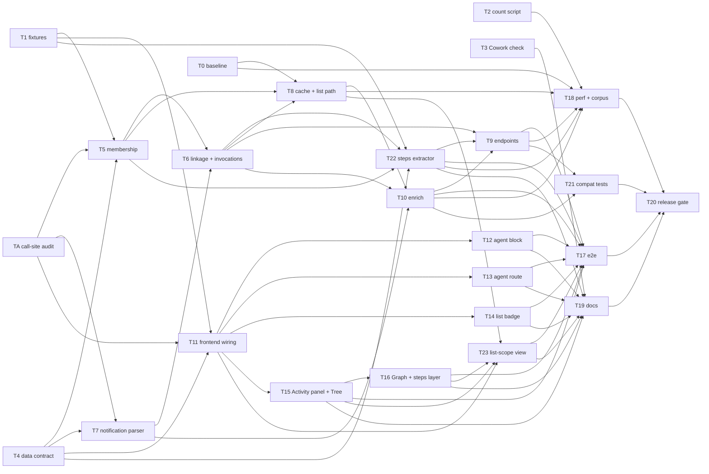

# Subagent viewer, call DAG, and live view

- **Status:** RATIFIED by LLM Council, 2026-10-23. All three members agreed in round 3 of 3 (section 11).
- **Council members:** Claude Opus 5.5 (author and CTO), `openai/gpt-6.1-sol` (the user asked for GPT-6-Sol, which PAL does not have), and `google/gemini-3.5-flash`.
- **Council review 2** (2026-10-23, after the user's human review): the same three members agreed in round 3 of 3. It covered these parts (§11):
  - §8, backfill and backward compatibility;
  - §12, the task DAG;
  - the new tool-call design in step 1.6.
- **Review 3** (2026-10-24, a two-member review, not a full council): `chatgpt/gpt-6-astra` reviewed every part that no council had reviewed (§2.5 and its edits, §7 notes, §12.1, §13), with Claude Opus 5.5. Astra agreed in round 3 of 3. See §11.
- **Review 4** (2026-10-26, a two-member review, not a full council): `chatgpt/gpt-6-astra` with Claude Opus 5.5 reviewed step 1.6b, the list scope that PR #26's list filters make possible. Astra agreed in round 3 of 3. See §11.
- **Competitive analysis applied** (2026-10-24): see §2.5. The changes come from the ratified decisions in [REALTIME_SUBAGENT_MONITORING_COMPETITIVE_ANALYSIS.md](./REALTIME_SUBAGENT_MONITORING_COMPETITIVE_ANALYSIS.md) and from facts verified on disk. Two items (ghost agents and legacy progress rows) are new facts that no council reviewed.
- **Depends on:** nothing for Phase 1. Phase 2 extends [LIVE-VIEW.md](./LIVE-VIEW.md), which is not built yet and must first be amended (step 2a).

## 1. Why the user needs this

A Claude Code session often hands most of its work to subagents. The user sees almost none of that work in Claude Explorer today.

- **What the user sees today** (checked with Playwright on session `db33af2b`, 2026-10-23):
  - The "Tool: Agent" block shows only raw input JSON: `description`, `subagent_type`, and `prompt`.
  - For a background agent, the "Tool Result" block shows only "Async agent launched successfully… agentId: …".
  - The final report arrives later as a "You" bubble that holds raw `<task-notification>` XML.
  - That one agent made 55 tool calls (Bash, fetch, Playwright, WebSearch). The app shows none of them.
- **What the user wants:**
  - Open any Agent call and read what that agent did.
  - Go from a main session to all of its subagents, and back.
  - See the shape of the work as a DAG: which session or agent spawned which agent, and in which order.
  - Later, watch running agents in real time.

## 2. Facts verified on disk (2026-10-23, this laptop)

### 2.1 Three file layouts

| Layout | Path | Transcripts | Meta files | Notes |
|---|---|---|---|---|
| Legacy | `<project>/agent-<id>.jsonl` | 1478 | none | File dates from 2025-10-27 to 2026-04-07 (corrected 2026-10-24: an earlier text sort of `stat` dates gave 2025-10-31). IDs are 7 hex characters. `sessionId` on the first user row names the parent. |
| Current | `<project>/<session>/subagents/agent-<id>.jsonl` | 963 | 921 | The directory name is the parent session's file stem. |
| Workflow | `<project>/<session>/subagents/workflows/<runId>/agent-<id>.jsonl` | 264 | 264 | 7 runs. Each run also has a `journal.jsonl`. |

- **Meta without transcript:** 0.
- **Current transcripts without meta:** 42.
  - 30 are `agent-acompact-<hex>` (context-compaction runs).
  - 5 are `agent-aside_question-<hex>` (side questions).
  - 7 have a plain hex ID.
  - Compaction runs and side questions are internal runs of Claude Code. The user did not launch them.
- **Agent IDs:** 2,705 distinct IDs in all three layouts, with no duplicates.
  - Real ID shapes: `a77005555a59b3ed4`, `5a2c48d6` (legacy), `aside_question-fd260f3de7d1db26`.
  - All match `^[A-Za-z0-9_-]{1,64}$`.
- **Out of scope:** the other session subdirectories, `tool-results/` (141), `remote-agents/` (6), and `memory/`.

### 2.2 The link keys

- **`.meta.json` keys** (number of files that have the key, out of 1185):
  - `agentType` (1185), `description` (928), `toolUseId` (556), `spawnDepth` (316).
  - `requestShape` (97: 89 `background`, 8 `foreground`), `requestNonInteractive` (97).
  - `worktreePath` (45), `spawnedWithWorktree` (41), `worktreeBranch` (41).
  - `model` (17), `isFork` (14), `parentAgentId` (14), `workflowPhase` (8).
- **`toolUseId`** equals the `tool_use.id` of the Agent call that started the agent.
- **`parentAgentId` with `spawnDepth: 2`** marks an agent that another agent spawned (14 files). The call for that agent is in the caller agent's transcript, not in the main session.
- **Meta files without `toolUseId`:** the agent's first user message equals the `input.prompt` of exactly one Agent call in the parent. This was true for 60 of 60 files checked.
- **Legacy ownership:** 1,437 of the 1,478 legacy files have a `sessionId`. For all 1,437, the file `<sessionId>.jsonl` exists in the same project directory. The other 41 have no `sessionId`.
- **Legacy call links:** the prompt text appears in the parent file for 33 of 60 sampled legacy files.
- **Workflow agents** have no `toolUseId`. The parent's `Workflow` tool result has `toolUseResult.runId` (for example `wf_e583cbaf-0b7`). That value equals the run directory name. `journal.jsonl` has one `started` row per agent, with `agentId`, `label`, and `phase`.
- **`SendMessage`** with `input.to = <agentId>` continues an existing agent. The same agent JSONL grows, with a new `promptId`. On agent `a5d2d5d0e20e083f6`, there are two `promptId` values.

### 2.3 What the parent file records

- **A call that waits for the agent** (121 calls in session `76fe578b`):
  - The tool result holds the agent's final text.
  - `toolUseResult` holds `agentId`, `agentType`, `status`, `totalDurationMs`, `totalTokens`, `totalToolUseCount`, `usage`, and `toolStats`.
- **A background call** (12 in `76fe578b`, all 23 in `db33af2b`):
  - The tool result says only "Async agent launched".
  - `toolUseResult` holds `isAsync`, `status`, `agentId`, `description`, `resolvedModel`, `prompt`, and `outputFile`.
  - Later, a user row holds a `<task-notification>`. Its tags are `<task-id>` (the agentId), `<tool-use-id>`, `<output-file>`, `<status>`, `
`, `<note>`, `<result>`, and `<usage>` (`subagent_tokens`, `tool_uses`, `duration_ms`).
  - The same task-id can notify more than once, because the user can resume the agent.
- **The parent file has no `progress` rows.** The only live source of agent activity is the agent's own JSONL file.

### 2.4 What the app does today

- **The API keeps the link IDs.** `tool_use.id` and `tool_result.tool_use_id` reach the frontend. `toolUseResult` does not.
- **Discovery reads only the legacy layout.** `build_agent_index_with_summaries` (`backend/cc_agent_reader.py:139`) globs only `<project>/agent-*.jsonl`. It never finds the 1,227 current and workflow transcripts.
- **The sidebar never asks for subagents.** `api.getConversations` (`frontend/src/lib/api.ts:52`) does not send `include_subagents=true`. So the Bot badge in `ConversationList.tsx:823` never shows.
- **A subagent row cannot be opened.** `SubagentListItem` (`ConversationList.tsx:857`) has no click action. Its `message_count` is always 0.
- **Every tool looks the same.** `ToolUseBlock` (`frontend/src/components/message/blocks/ToolBlocks.tsx:17`) shows a JSON dump for every tool name.
- **Search does not index subagent transcripts.** `discover_jsonl_files` (`backend/cc_jsonl_io.py:201`) skips `agent-*`.
- **The list path does extra work.** On every `/api/conversations` call, the legacy index reads the head of all 1,478 legacy files. No caller uses the result.

### 2.5 Findings from the competitive analysis (2026-10-24)

The analysis read five competing tools in depth and verified their claims on this laptop. These findings change Phase 1:

| # | Finding | Evidence | Change in this plan |
|---|---|---|---|
| C1 | 82 of 2,403 Agent results (3.4%) name an `agentId` whose transcript was not found anywhere under the home folder ("ghost" agents). agtop rebuilds such rows from the parent. They belong to 2 sessions in 2 projects, not Claude Desktop sessions: neither session appears in Claude Desktop's data, and one records `entrypoint: cli`. All use Claude Code 2.0.76 in January 2026; all are sync, completed calls with 7-hex-character IDs. Missing-transcript calls precede 2026-01-25T18:56Z; calls with a kept transcript follow 2026-01-25T20:14Z. Time Machine backups explain it: the default 30-day cleanup ran on about 2026-02-24 and deleted every file older than about 2026-01-25. Older files were restored later, but no backup covered 2025-12-19 to 2026-02-25, so these 82 are lost (analysis §12). Calls without an `agentId` are not counted as ghosts. | A scan of all parent files, of the whole home folder, and of Claude Desktop's data folder | Step 1.1: a ghost agent is a node with `transcript_state: missing`, built from the parent's evidence. It is not dropped. |
| C2 | `type: progress` rows with `agent_progress` exist only in 2026-03 files. All 4 sessions that have them also have subagent transcripts. | A scan of all parent files | Step 1.1: when a transcript exists, ignore these rows, so that nothing counts twice. Use them only for a ghost agent. |
| C3 | 2 of 14 lifecycle files have bytes after the first JSON object; first-object parsing succeeds on them. All 1,197 agent meta sidecars parse with plain `json.loads` (scanned 2026-10-24), so for meta files tolerant parsing is a defense, not a fix for an observed defect. | `json.load` and `raw_decode` on every file | Step 1.1: tolerant parsing of single-object sidecars, with a last-valid copy (decision T1′). |
| C4 | Competitors build wrong trees: claude-devtools treats only `Task` as a spawn; zoetrope puts nested agents under the main session; Agent Flow links by display name. | The cloned code at the commits in the analysis | No design change. These cases become named tests, so that our advantage is proved. |
| C5 | A fold that does not depend on the order of the files, with a shuffle test (zoetrope). | zoetrope `src/state/session.rs:40-60` | Step 1.1: `build_graph` gives the same graph for any read order. |
| C6 | Usage: group assistant records by `message.id`, and take the last `usage` as the true value (flightdeckhq). | flightdeckhq `observe_cli.mjs:1116-1250` | §4.7: token totals use this rule. |
| C7 | "A spawn acknowledgment is not completion." The UI words for an async agent with no notification (decision T2′). | zoetrope `src/state/session.rs:588-`; analysis §6.2 | Step 1.4: the chip says "launched; completion not observed". |

## 3. Goals and non-goals

### Goals

1. **Phase 1:** read any subagent transcript, linked to its call, for all three layouts.
2. **Phase 1:** show the session's agents as a Tree and as a graphical DAG.
3. **Phase 1b:** find text inside subagent transcripts with search. Show agent facts in exports.
4. **Phase 2:** watch running agents in real time, in the agent view and in the DAG.

### Use cases (council review 2, ranked by user value)

| Rank | ID | The user asks | Phase |
|---|---|---|---|
| 1 | U1 | "What did this session hand off, and what came back?" | 1 |
| 2 | U4 | "Which step failed?" Phase 1 shows known failed invocations and errors in the activity that the user opened. A tool error is not an agent failure. | 1 (session-wide scan: 1b) |
| 3 | U9 | "Where is the answer?" The agent's report is one click from every agent node and block. | 1 |
| 4 | U2 | "What did this agent do, step by step?" The app shows the steps and their times. It makes no claim about why a step took long. | 1 |
| 5 | U7 | "Follow this branch." Focus on one agent and its children. | 1 |
| 6 | U3 | "Where was the activity?" Counts of each agent's own calls, with coverage. A count is not a cost. | 1 |
| 7 | U10 | "Where did the tokens go?" Tokens on each node, from usage evidence, with coverage. No money estimate. | 1 (color by tokens: 1b) |
| 8 | U5 | "What ran in parallel?" Parallel batches and times. No "waited on" claims. | 1 |
| 9 | U6 | "Which agent read file F, searched for Q, or ran command C?" | 1b |
| 10 | U8 | "What is each running agent doing now?" | 2 |
| — | U11 | "What did the agents do across this project, folder, or list?" The list scope of step 1.6b. Added 2026-10-26; not ranked by a council. | 1 |

### Non-goals

- **Remote agents** (`remote-agents/`). They run in the cloud.
- **Cowork sessions.** Their subagent layout is not checked yet. Step 1.0 adds that check. A later plan covers Cowork if it has subagents.
- **New MCP tools.** The MCP server keeps its 5 tools.
- **Full agent transcripts nested inline in the parent stream.** The agent route shows the full transcript (decision R2).
- **A timeline view, and per-turn grouping in the DAG.** Measure on the 295-agent session first (decision R18).

## 4. Data model

### 4.1 Membership and call linkage are two separate facts

- **Membership** answers "which session owns this agent?". It comes from the directory:
  - current and workflow layouts: the `<session>` directory;
  - legacy layout: the file `<sessionId>.jsonl` (verified for 1,437 of 1,437 files);
  - the 41 legacy files without `sessionId` have unknown ownership. The diagnostics list them.
- **Call linkage** answers "which call started this agent?". It uses these rules, in this order (decision R7′):
  1. `toolUseId` from the meta file.
  2. Else, a prompt match. The match must be unique, and only the Agent calls of the **verified immediate caller** count:
     - for a depth-1 agent, the calls in the root session;
     - for a nested agent, the calls in the transcript of the `parentAgentId` agent.
  3. Else, `link_quality` is `ambiguous` (more than one match, with the candidates listed) or `unresolved`.
- **No guessed links.** The backend never links by time window or by the nearest call (decision R3).

### 4.2 Nodes and edges

- **Nodes:**
  - `session`: the main session. There is exactly one root.
  - `agent`: one subagent transcript. Key: `agent_id`.
  - `workflow`: one workflow run. Key: `run_id`.
- **Topology edges** (decision R6). These form a forest under the session root:
  - `spawned`: from the caller (session or agent) to the agent.
  - `launched_workflow`: from the session to a workflow node.
  - `member`: from a workflow node to each of its agents.
- **Annotation edges:**
  - `continued`: from the sender of a `SendMessage` to the agent.
  - These edges can point back or form cycles. The layout never uses them. The Graph view draws them on top, as dashed lines.
- **Unknown parent:** an agent with membership but no call link sits under the session in an "Unlinked" group. No edge claims a call that the files do not prove.

### 4.3 Invocations and status (decision R9)

- **An invocation** is one Agent call, or one `SendMessage` to an agent. Each invocation has its own record:
  - `tool_use_id`, `prompt_id` (if known), `kind` (`spawn` or `continue`);
  - `outcome` (`completed`, `failed`, `killed`, `interrupted`, `launched`, `unknown`, or the raw status text if it is new);
  - `usage` (tokens, tool uses, duration) and the source of each value (`tool_result` or `task_notification`).
- **Each source counts once per invocation.** A notification and a tool result for the same invocation do not add twice.
- **The outcome comes only from evidence,** in this order:
  1. a task-notification for that invocation;
  2. a non-async tool result for that invocation;
  3. `launched`, if the call was async. The UI shows it as "launched; completion not observed" (C7);
  4. `unknown`.
- **What the UI shows:**
  - Each Agent block and `SendMessage` block shows the outcome of its own invocation.
  - The agent header shows the latest invocation's outcome.
  - The header also shows totals over all invocations, with coverage (for example "2 of 3 invocations report usage").

### 4.4 Pydantic models (`backend/models.py`)

- **`SubagentNode`:**
  - `agent_id`, `agent_type`, `description`, `model`;
  - `is_internal: bool` (true for `acompact-*` and `aside_question-*`);
  - `owner_session_uuid`;
  - `caller_kind` (`session`, `agent`, `workflow`, or `unknown`) and `caller_id`;
  - `tool_use_id`, `link_quality` (`exact`, `prompt_match`, `ambiguous`, `unresolved`), and `link_candidates`;
  - `invocations: list[Invocation]`;
  - `started_at`, `last_write_at`;
  - `evidence` (`complete` or `partial`) (decision R10′);
  - `transcript_state` (`present` or `missing`). A ghost agent (C1) has `missing`;
  - `workflow_run_id`, `workflow_phase`.
- **`WorkflowNode`:** `run_id`, `name`, `summary`, `tool_use_id`, `agent_ids`.
- **`SubagentEdge`:** `kind`, `source`, `target`, `tool_use_id`, `message_uuid`.
- **`SubagentGraph`:**
  - `session_uuid`, `agents`, `workflows`, `edges`;
  - `diagnostics` (decision R4): files skipped, parse failures, files with trailing bytes (C3), unknown layouts, ghost agents (C1), and agents with unknown ownership.
- **Counters can be `null`.** `null` means "unknown". The UI shows "—", not 0.

### 4.5 The transcript locator (decision R11)

- **One locator for every place that names a message:** `{session_uuid, agent_id | null, message_uuid}`.
- **The agent detail payload** keeps `uuid = session_uuid` and adds `agent_id`. There are no slash IDs.
- **`agent_id` is part of every cache key** for an agent transcript, and part of every future bookmark identity.

### 4.6 The link on a tool block

- **`ContentBlock` gets one optional field: `subagent_ref`.**
  - It is set on `tool_use` blocks named `Agent`, `Task`, `SendMessage`, and `Workflow`.
  - Fields: `agent_id` or `run_id`, `agent_type`, `description`, and this invocation's outcome and usage.
- **The frontend reads only this field.** It never parses `toolUseResult` or the notification text.

### 4.7 The steps contract (tool-call activity)

The "Show steps" list (step 1.4) and the tool-call layer of the Activity panel (step 1.6) use one endpoint and one shape.

- **Endpoint:** `GET /api/conversations/{uuid}/steps?agent_id=<id>&cursor=<c>&limit=50&from=end`.
  - Without `agent_id`, it returns the session root's own calls.
  - `from=end` gives the last page first (the most recent work).
- **One `Step`:**
  - `locator` (§4.5) and `tool_use_id`, so navigation never depends on list positions or times;
  - `position` (order in the transcript) and `prompt_id` (the invocation, for a resumed agent);
  - `name` and `input_summary` (the command, file path, URL, or query, cut short);
  - `target`: the child `agent_id` for `Agent` and `Task`, the `run_id` for `Workflow`, else null;
  - `parallel_group`: the `message.id`. A step without a `message.id` is never grouped with another step;
  - `result_state`: `present` or `missing`;
  - `is_error`: `true`, `false`, or `null`. The value comes from the raw rows, because the API `ContentBlock` drops it. `null` means "no flag in the file". The UI shows it as "no error reported", never with a success color;
  - `started_at`, `ended_at`, and `elapsed_ms`, all nullable. `elapsed_ms` is the observed call→result time. It can include waits, such as a permission prompt (verified: median ratio 1.00, maximum 14× for 121 sync Agent calls);
  - `turn_index`: the number of the real user prompt. Tool-result rows and notification rows do not start a turn.
- **Page envelope:**
  - `items`, `cursor_before`, `cursor_after`, `total_count`;
  - `aggregates` for the whole transcript, not for the page: own-call counts by tool name, the error count, and token totals;
  - **Token totals** (C6):
    - Compute them from the assistant records on the active branch, separately for each transcript.
    - Group records that have a non-null `message.id`. For each group, take the last valid `usage` object in transcript order, and ignore later records without `usage`.
    - Never group records under a null ID. A record without `message.id` is its own group, by its stable row identity.
    - Missing `usage` stays unknown and lowers the coverage. It is not zero.
    - Keep invocation-reported usage (from `toolUseResult` or a notification) separate from transcript-derived usage. Never add the two.
    - T4 defines the token components, the total formula, and the coverage fields before anyone codes or writes tests;
  - `coverage` and `diagnostics`.
- **Pages break at batch boundaries.** A batch that is larger than one page becomes one summary item with a count. Its own detail is paged.
- **Branches:** the same active-branch rule as the transcript route.
- **Cache:** keyed by the locator. It depends on the transcript file and on the evidence that links its targets.

## 5. Phase 1 — Static subagent viewing

Every step starts with a failing test (CLAUDE.md, "Code Style"). Each step is one commit, or a small group of commits.

### Step 1.0 — Measurement, fixtures, and counts

- **Measure first** (Performance Work invariant 3). Record these numbers on the real corpus:
  - cold and warm `/api/conversations`;
  - cold and warm parent detail for the 295-agent session (`a70251a5`);
  - the graph endpoint and one agent detail, after they exist;
  - peak RSS of the server process.
- **Use repeated runs.** Record the median and p90 of at least 10 runs. Do not compare one run to one run.
- **Build a fixture tree** under `backend/tests/fixtures/subagents/`. It has one session for each case:
  - legacy with `sessionId`, and legacy without `sessionId`;
  - current with `toolUseId`, and current without it;
  - nested (`parentAgentId`);
  - workflow;
  - `SendMessage` continuation of a completed agent;
  - two Agent calls with the same prompt;
  - internal runs only (`acompact-*`, `aside_question-*`);
  - a ghost agent: an Agent result whose `agentId` has no transcript (C1);
  - a 2026-03 session with `agent_progress` rows and a transcript (C2);
  - a meta file with trailing bytes after its JSON object (C3);
  - a generated session with 295 agents.
  - Copy the field shapes from real files and scrub the content.
- **Write `scripts/count_subagents.py`.** It counts transcript IDs on disk by layout. It lists internal runs and the 41 legacy files with unknown ownership in separate rows.
- **Check Cowork.** Look for subagent files under the Cowork session roots. Record the result in this plan.

### Step 1.1 — Discovery (`backend/cc_subagents.py`, new)

- **Three separate layers** (decision R10′):
  1. `parse` — read one agent transcript. Reuse `read_claude_code_conversation`.
  2. `build_graph(session)` — make a `SubagentGraph`. It reads only the root session (already parsed), the meta files, the journals, and, for depth-1 agents without `toolUseId`, the first user row.
  3. `enrich(conversation, graph)` — set `subagent_ref` on tool blocks.
  - `parse` never calls `build_graph` or `enrich`. So reading an agent transcript cannot start another discovery.
- **Nested agents load lazily.** The caller evidence for a nested agent loads when the user opens that agent, or asks for its relationships. Until then, the node has `evidence: partial`.
- **`subagent_count`:**
  - It is the number of distinct agent transcript IDs in all three layouts, without internal runs (decision R8).
  - `internal_run_count` is a separate number (decision R19′).
  - The list path gets both numbers from directory listings and the cached legacy ownership map. On a warm cache, it opens no agent file.
- **Cache in the existing SQLite `summary_cache`** (decision R8′). Make no new cache layer.
  - **Membership** depends on the mtimes of `subagents/`, `subagents/workflows/`, each run directory, and the project directory (for legacy files). A directory that changes from missing to present also counts as a change.
  - **Evidence** depends on the (mtime, size) of the session transcript, each caller transcript that was read, each meta file, and each journal.
- **Tolerant parsing** (decision R4). One bad file never fails the graph or the session.
  - If a meta file, a journal, or a transcript fails to parse, the backend skips it and adds an entry to `diagnostics`.
  - A file in an unknown layout also adds an entry.
- **Sidecar parsing** (C3, decision T1′):
  - Use first-object parsing only for single-object JSON sidecars (`.meta.json`, lifecycle files). Parse journals and transcripts as JSONL.
  - Skip leading whitespace, decode the first object, and record any trailing bytes that are not whitespace as a diagnostic.
  - Keep a record for each file: its current `(inode, mtime_ns, size)` fingerprint, and the last object that decoded, with that object's fingerprint.
  - If a changed file fails to parse, keep the last valid object for the same owner and file. Add a diagnostic with `stale: true` and both fingerprints. With no earlier valid object, use no metadata.
  - On deletion, or when the file's owner changes, discard the kept object. A later valid read replaces it and clears the stale state.
- **Ghost agents** (C1). An agent node stands for an observed agent identity, with or without a transcript.
  - Pair each `Agent` or `Task` result with its call by `tool_result.tool_use_id`. An explicit `toolUseResult.agentId` gives an exact call-to-agent link inside the caller's owning session.
  - Conflicting identity evidence gives a diagnostic, not an arbitrary winner. Find these identities before parsing notifications for known agents.
  - An agent with no transcript gets `transcript_state: missing`. Its facts come from the parent: the prompt, the result, the outcome, and the usage, each with a source locator.
  - It is not in `subagent_count`, which counts transcripts. `diagnostics` lists it.
  - **Its agent route** returns 200 with its invocations and the parent's prompt and result. It shows "Transcript not on disk" and never invents transcript messages.
  - **Its steps route** returns its verified legacy progress steps, if any. Otherwise it returns no items, unknown aggregates, and coverage "unavailable". A missing source is not proof of zero activity.
  - **A transcript that exists but cannot be read is not a ghost.** It keeps its identity, and the read failure goes into `diagnostics`.
  - T4 adds these fields to the contract. T9, T12, T13, and T15 build the behavior.
- **Legacy progress rows** (C2).
  - When a transcript exists, ignore its `agent_progress` rows for steps and aggregates.
  - For a ghost, accept only progress records whose explicit identity resolves to that agent inside the owning caller. Remove duplicates by their stable identity. Keep the parent-source locators.
  - Progress-derived activity and invocation-reported totals are separate evidence. Never add them.
  - No progress records does not mean zero activity.
  - The ghost-with-progress case is synthetic: all 4 observed progress sessions had transcripts.
- **Order does not matter** (C5). `build_graph` gives the same graph for any order of reading the files. A shuffle test proves it.
- **`cc_agent_reader.py`:** remove the per-request legacy scan from the list path. Fix the module docstring, which describes only the legacy layout.

### Step 1.2 — Endpoints (`backend/routers/conversations.py`)

- **`GET /api/conversations/{uuid}/subagents`** returns the `SubagentGraph`.
- **`GET /api/conversations/{uuid}/subagents/{agent_id}`** returns a `ConversationDetail`-shaped transcript with `agent_id` set (decision R5).
  - The agent's own tool calls render the same way as the main session's.
  - The agent's own Agent calls get `subagent_ref` from the same session graph.
- **Input safety** (TESTING §5.9, decision R12):
  - `agent_id` must match `^[A-Za-z0-9_-]{1,64}$`, else 422 (decision R17).
  - The route finds `agent_id` in the session's graph. It never builds a path from the request text. An unknown ID gives 404.
  - The resolved real path must be under the owning session's project directory. A symlink that points outside gives 404.
  - The backend never uses the `<output-file>` value as a path.
- **`GET /api/conversations/{uuid}/steps`** returns one page of steps (§4.7). `backend/cc_steps.py` makes the page. The route only binds it.
- **Deprecate the old parts, then remove them one release later** (§8.3): the `include_subagents` query flag, and the `subagents` list on the summary models. While they are deprecated, they keep working. Add `subagent_count` and `internal_run_count` (both new: on main, checked 2026-10-26, the badge counts the `subagents` list).
- **Wire-payload tests:** the routes return `OrjsonResponse` (`backend/responses.py`, PR #21; it replaced FastAPI's deprecated `ORJSONResponse` with the same bytes), so `response_model` proves nothing. The tests parse the real response body and validate it against the model.

### Step 1.3 — Tool blocks and notification rows

- **`subagent_ref`:** `enrich` sets it from the graph (section 4.6).
- **Stable message identity** (decision R5): merged messages get a top-level `message_id` (the Anthropic `message.id`). This is the dedup key for Phase 2 (LIVE-VIEW.md decision 9).
- **Notification rows** (decision R12):
  - A user row is a notification only if both conditions are true:
    - its text starts with `<task-notification>`;
    - its `<task-id>` is a known agent of this session.
  - The parser extracts the fixed tags with a bounded regex. It does not use an XML parser.
  - If a tag is missing or malformed, the row stays raw text.
  - A parsed row gets `task_notification: {task_id, tool_use_id, status, summary, result, usage}`.
  - The raw text stays in `content`, so search and export do not change.

### Step 1.4 — Agent block in the parent stream (frontend)

- **New `AgentToolBlock`** in `frontend/src/components/message/blocks/`. `ContentBlockRenderer` uses it when a `tool_use` block has `subagent_ref`.
  - **Header:** agent type, description, outcome chip, tool count, duration, and tokens. Example, from the real notification (description replaced for privacy) for agent `ae52567b5b2b1b29e`: "Agent · general-purpose · Research topic A and topic B · 36 tools · 3m 48s · 99.6k tokens · completed".
  - **Prompt:** shown as Markdown. A "Raw input" toggle shows the JSON view.
  - **Result:** the agent's final report, if the files hold it.
  - **"Show steps":** loads one page from the steps endpoint (§4.7) when the user opens it. It shows one line per tool call: name, short input, error state, and elapsed time. It never renders a full transcript inline (decision R2).
  - **"Open agent":** opens the agent route (step 1.5).
- **The "Async agent launched" tool result** renders as one line with an "Open agent" button (decision R16). A toggle shows the full text.
- **An async agent with no notification** shows the chip "launched; completion not observed" (C7). It never says "running" in Phase 1.
- **A ghost agent** (C1) shows its prompt, its result, its recorded outcome (for example `completed`), and the note "Transcript not on disk". "Show steps" shows its verified legacy progress steps, or "Steps unavailable". A missing transcript neither erases nor invents an outcome.
- **A notification row** renders as a "Subagent finished" card, not as a "You" bubble. The card shows the status, summary, and usage, and has an "Open agent" button. A "Raw" toggle shows the text.
- **`SendMessage` and `Workflow` blocks** get a short header and a button that opens the target agent or the workflow node.
- **Performance invariant 1:** these blocks render inside the message list. They must not call `useContext` on `SettingsContext`, `SearchPanelContext`, or `BookmarksContext`. `ConversationPage` passes the values as props.

### Step 1.5 — Agent route and navigation

- **New route `conversations/:uuid/agents/:agentId`.** It shows the full agent transcript in the Conversation Pane.
  - A breadcrumb shows each step from the session to the agent: "Session › Agent › Nested agent". Each part is a link.
  - The header shows the same facts as `AgentToolBlock`, plus each invocation.
  - Show Tools, Expand, and Markdown export work the same as for a session.
- **Back to the parent:** the breadcrumb opens the caller and scrolls to the call (`#tool-<toolUseId>`). The call gets a short highlight.
- **Conversation List** (decision R15):
  - The Bot badge shows `subagent_count`.
  - A click on the badge opens the conversation with the Activity panel open (`?panel=agents`), in the session scope. The list parameters (`project`, `path`, `pin`, `q`, `title`) stay in the URL.
  - Agents are never rows in the Conversation List. Remove the existing expand list and `SubagentListItem`.

### Step 1.6 — Activity panel: subagents and tool calls, as a Tree or a Graph

The panel answers the use cases in §3. It shows the session's subagents, the tool calls, or both.

#### Where the panel opens (decision S17′)

- **An "Activity" toggle** in the conversation header opens the panel above the message stream.
- **The toggle shows** when `isClaudeCode && (subagent_count > 0 || internal_run_count > 0 || hasOwnToolCalls)`.
  - `hasOwnToolCalls` comes from data that is already loaded (the open conversation, or list metadata). The app never makes a steps request only to decide this.
  - If the app does not know, it shows the toggle.
- **`?panel=agents` always opens the panel.** For a chat-only session, the panel says "This session has no activity to show".

#### Two views of the same data (decision R18)

- **Tree:** an indented outline. It is the default when the session has more than 50 agents. It is also the view for screen readers.
- **Graph:** a DAG drawn with `@dagrejs/dagre` for the layout and plain SVG for the drawing. It is the default when the session has 50 agents or fewer.
- **The Tree has the same switches, focus, limits, and notices as the Graph** (decision S20). It shows them as nested rows, not as SVG geometry.

#### Two independent switches (decision S15)

The user turns **Subagents** and **Tool calls** on and off separately. The **anchor** is the session, or the agent in focus. The anchor is always shown.

| Subagents | Tool calls | The panel shows |
|---|---|---|
| ON | OFF | The anchor and its agent hierarchy. This is the default. |
| ON | ON | The same hierarchy. Each agent node also shows chips for its calls. One scope at a time can expand into its calls. |
| OFF | ON | Only the anchor's own calls, in recorded order. `Agent`, `Task`, and `Workflow` calls are ordinary steps. Child transcripts do not expand. |
| OFF | OFF | The anchor and the message "Both layers are hidden". |

- **The Subagents switch is disabled** (with the tooltip "This session has no subagents") only after graph discovery finds no agent nodes at all: no transcripts, no internal runs, and no ghost agents. `subagent_count` stays the count of transcripts.
- **These switches are separate from the transcript's Show Tools setting.**

#### Focus on one agent (decision S11)

- **"Focus" on an agent** makes it the anchor.
  - A breadcrumb above the panel shows its ancestors. If the ancestry is unresolved, the breadcrumb says so. It does not draw a path.
  - The Subagents switch controls the agent's descendants. Descendants start collapsed.
  - Focus does not turn on Tool calls. If Tool calls is off, the panel offers "Show calls".
  - The app loads the steps of the focused agent only, not of its subtree.
- **Exit:** an explicit exit button, or the breadcrumb. Esc exits focus only when the panel has keyboard focus and nothing else uses the key.
- **On exit,** the panel restores the earlier view, switches, selection, and viewport.
- **URL:** `?panel=agents&focus=<agentId>`. The backend checks `focus` against the session. An unknown ID shows a message and a way back. The app never shows an empty graph for it.

#### How tool calls appear (decision S10)

- **The spawn topology does not change.** The agent-only layout is the same with Tool calls on or off.
- **Calls are in recorded order.** A connector between two steps means "recorded next". It never means "depends on".
- **Parallel calls** (one `message.id`) sit side by side in one rank. Steps without a `message.id` are never grouped.
- **A child-agent branch attaches to the verified call that spawned it.** An async launch has no join edge back from the child.
- **`continued` edges** stay out of the layout, as before (decision R6).
- **A step node shows:** tool name, short input, error state, and observed elapsed time. A click opens the agent route at that call.

#### Limits (decision S16)

- **One expanded scope at a time.** Only one agent (or the session root) shows its calls as nodes at one time.
- **A page has 50 calls.** At most 200 step nodes are in the Graph at one time. "Next page" replaces the visible window. It never adds to it.
- **There is no "Expand all".**
- **The session root** (up to 14,485 own calls) opens on its last page, with "Earlier" and "Later" controls (decision S19).
- **These numbers are starting values.** T16 must check them with a benchmark on the 426-call agent and the 14,485-call session root. The benchmark measures layout time, mounted nodes, memory, and input latency.

#### Chips and counts (decisions S13, S18)

- **Chips use only data that the app already has:** `toolStats` and the notification's `<usage>`. Else the chip shows "—".
- **The app never loads 295 steps pages because the user turned on Tool calls.**
- **Chip labels say "own calls".** A node shows the top 3 chips and "more".
- **Tokens** show on each node as a fact, with coverage. Color by tokens or by elapsed time is Phase 1b. The app shows no money estimate.
- **Error notices are exact.** The panel says "No errors in inspected activity", never "No errors".

#### Groups and keys

- **Groups in the Tree:**
  - "Unlinked" holds agents without a call link.
  - "Internal runs" is collapsed. It holds compaction runs and side questions (decision R19).
- **Keyboard** (decision R20):
  - The Tree uses the same Vim, Emacs, and arrow keys as the Conversation List (UX.md §2).
  - Enter opens a node. Right expands it. Left collapses it.
  - The panel is part of the Conversation Pane in the `focusArea` model.
  - Each Graph node is a focusable button with an `aria-label`.

#### Not in Phase 1 (decision S14)

- Expanding the calls of more than one agent at the same time.
- Filling in missing chip counts in the background.
- A scan of the whole session for tool errors.
- Grouping by turn.
- Any claim about a critical path or about which agent waited on which.

### Step 1.6b — The list scope: subagents across the sessions in the Conversation List

Added 2026-10-26, after PR #26 ("filter the Conversation List by project, path, and recent activity", merged 2026-10-25). Reviewed by `chatgpt/gpt-6-astra` with Claude Opus 5.5 (a two-member review, not a full council); see §11, review 4.

**Why.** The user filters the Conversation List to a project or a folder, and then wants to see the subagents of every session in that list, or of one session.

#### The two scopes

- **Session scope** (as above): the open conversation and its agents.
- **List scope** (new): every session that passes all the Conversation List's filters now (UX.md "Conversation List filters"):
  - source, workspace, and title search;
  - the active named filter and the URL title filter;
  - project (`?project=`) or path (`?path=`);
  - recent sessions (`[x] Last [N] h`, on by default with N = 24);
  - empty sessions and archived sessions.
- **No exceptions** (UX.md, PR #26; the user's rule of 2026-10-25). A session that a filter hides is not in the list scope, also when it is open.
  - It is absent from the rows, the totals, the expanded content, and the selection.
  - The session scope still works for the open conversation, because the Conversation Pane keeps it on screen.
- **Folder collapse is not a filter.** Membership includes sessions in collapsed sidebar folders and sessions outside the sidebar's visible area. Collapse changes only the sidebar's presentation and keyboard order.

#### One rule in one place

Checked on main (2026-10-26): `useConversations` fetches the full list under one cache key without the search text, then filters by title inside the hook. `ConversationList.tsx` then applies project or path, recent, URL title, and named filters in a `useMemo`, and orders the rows (starred first, then folders when grouping applies).

- **Extract the local filter step** into a pure exported `visibleConversations(...)` in `frontend/src/lib/conversationListView.ts`. It reuses `matchesProjectFilter`, `isRecent`, and the existing title and named-filter evaluators. It takes the result of `useConversations` and an explicit `nowMs`. It does not repeat any filter that `useConversations` or the backend owns.
- **Extract the ordering** (flat starred-first order, and `groupingApplies` with `buildFolders` when grouping applies) into a pure function too, `orderedConversations(...)`. The list scope uses the full order **before** folder collapse.
- **One owning hook,** `useConversationListView()`, gives both views the same query inputs (`listQueryFilters`), local filter inputs, and clock snapshot (`useNow`). So both read one React Query entry and one cutoff.
- **The sidebar's project options** keep coming from the list before the project, path, and recent filters (PR #26 contract).

#### Where the list scope opens

- **Sidebar:** an "Activity" button next to the project select. It opens the list scope. It is available without an open conversation, and also when the filtered list is empty (it then shows the empty state).
- **The conversation header's "List" menu** (PR #26): a new item, "Activity for this list". It inherits the menu's own visibility rule (a Claude Code session with a `project_path`).
- **In the Activity panel:** a scope switch, "This session" and "This list". "This session" is disabled, with an explanation, when no conversation is open.
- **S17′ still governs only the session-scope Activity toggle** in the conversation header. The sidebar's list entry does not use it.

#### URL and state rules

- **List scope:** `panel=agents&scope=list`, and no `focus`.
- **Session scope:** `panel=agents`, no `scope=list`, and an optional `focus=<agentId>`.
- **A URL with both `scope=list` and `focus`** resolves to the list scope and removes `focus`.
- **Every transition keeps the unrelated parameters** (`project`, `path`, `pin`, `q`, `title`, `filterMode`). Project and path keep PR #26's rule that only one is active. The recent settings stay user preferences.
- **Build each transition on `window.location`,** as `useSetListProjectFilter` does (`frontend/src/hooks/useUrlFilters.ts`). The search scope pin writes `?pin=` with `history.replaceState`, which the router does not see, so a write from the router's search params drops it.
- **Three route forms** carry the list (checked on main, `frontend/src/App.tsx`): `/conversations`, `/conversations/:uuid`, and `/projects/:projectSlug`. The list scope works on all three.
  - On `/projects/:projectSlug`, the slug is the project filter (`useUrlFilters`).
  - A transition that leaves that route (the Bot badge, focus, opening a session) moves the slug to `?project=<slug>`, so the project filter stays.
- **The Bot badge** (decision R15) opens that row's session, sets `panel=agents`, and removes `scope=list` and any earlier `focus`.
- **Switching to "This list"** clears `focus`.
- **Focus on an agent from the list scope** opens its session in the session scope with `focus` set, and removes `scope=list`.
  - The app keeps the list state of origin in memory: the view, the switches, the page, the expanded session, the selection, and the viewport.
  - Exiting focus returns to that list state (decision S11). The current filters still win: an excluded session does not come back, and an invalid page or selection is reconciled.
  - A focus URL opened directly or after a reload has no list state of origin, so its exit follows the session-scope rule.
- **Reload** restores the scope that the URL names. Back and Forward follow the same rules.

#### What the list scope shows

- **A header with totals for the whole filtered list,** across all pages, from list data only, with no extra request:
  - sessions in the list;
  - "sessions with subagent transcripts" (`subagent_count > 0`);
  - the sum of `subagent_count`;
  - the sum of `internal_run_count`.
  - These are metadata totals, not a count of every agent node. Ghost agents appear per session after its graph loads, and are not added to the totals. A missing count shows as unknown, never as 0.
  - **Where the counts come from:** task T8 fills `subagent_count` and `internal_run_count` in every list response (the T4 contract defines the fields). A source without a subagent layout, such as a Desktop chat, has 0. `null` means that the server did not compute the count.
  - If any count in the list is unknown, a sum shows "at least N".
- **Rows:** every session in the filtered list, including sessions whose counts are 0. A zero count does not prove that the graph has no agents (ghosts, or a session with only its own tool calls). There is no "Show sessions without subagents" switch in Phase 1.
- **If every count is 0,** the header says: "No subagent transcripts or internal runs reported in these N sessions. Expand a session to inspect its activity." Only a loaded graph can show that a session has no agent nodes.
- **Tree (the default in the list scope):** each session row shows its name, its counts, and its last activity. Expanding a session shows its graph with the same groups and keys as the session scope.
- **Graph:** one root node per session. Only the expanded session shows its agents. The other sessions are single nodes with their counts.

#### Limits and requests

- **At most one session is expanded,** in the Tree or the Graph. Inside that session, decision S16 still lets only one agent or session root show call nodes at a time. Changing the expanded session removes the earlier session's content.
- **The Subagents and Tool calls switches belong to the expanded session's view,** and follow all four combinations of decision S15, including the anchor, the "Both layers are hidden" message, and the graph-based rule for disabling Subagents. Focus keeps decision S11. There is no "Expand all".
- **Filter and order the full list, then page it before any row or layout is built.**
  - A page holds at most 50 session roots, with "Earlier" and "Later".
  - Agent content and call nodes are in addition to the roots, under the session-view limits.
  - A session with more than 50 agents opens in the Tree.
- **Opening the list scope makes no graph request.** Expanding a session requests only that session's graph, and none if a fresh cached graph exists. No other session's graph is prefetched.
- **When the page or the filters change,** an expanded session that left the page collapses, the selection is reconciled, and the page is clamped. A late response never brings back excluded content.

#### Recent filter and empty states

- **Both views use the same filter snapshot and the same clock.** With the recent filter on, membership is computed again at least once a minute.
- **The list scope reuses the Conversation List's loading, error, empty, and all-hidden states.**
- **When filters hide all loaded rows,** it names the active filters and shows only the clear actions that apply. Each action clears only its own filter, and the other filters still apply:
  - "Show all projects" removes project and path;
  - "Show older sessions" turns the recent filter off;
  - "Clear active filter" clears the named filter.

#### Rules that carry over

- **Performance invariant 1:** session rows and session root nodes are list-rendered (often more than 100). The owning view reads `SettingsContext`, `SearchPanelContext`, and `BookmarksContext` once and passes props. Verify it by component review and by the 3,100-session benchmark.
- **The search scope pin** keeps its meaning (UX.md §5): it dims rows, and it does not change membership.
- **Phase 2:** the multi-session live rail shows the running sessions of the list scope, so the same filters choose them.

#### Benchmark

- **3,100 sessions with the recent filter off:** measure the mounted elements, the layout time, the memory, and the input latency. T16's single-session benchmarks do not cover this view.

#### Not in Phase 1

- **A flat table of every agent in the list,** sortable by agent type, outcome, or time. It needs one graph request per session, or a new batch endpoint. Measure that first, in Phase 1b.

### Step 1.7 — Documents

- **UX.md:** add "§16. Subagents", including the list scope of step 1.6b, and link it from "Conversation List filters". It covers the agent block, the notification card, the agent route, the badge, the Agents panel, and its keys.
- **CLAUDE.md:** describe the three layouts, the membership and link rules, and the internal runs, near the search-index section.
- **LIVE-VIEW.md:** change "subagent files are out of scope" to point at Phase 2 of this plan.
- Then release Phase 1.

### Phase 1 tests (decision R13)

The full test spec is in [2026.10.24-subagent-viewer-test-cases.md](./2026.10.24-subagent-viewer-test-cases.md): 74 Phase 1 tests in 10 suites, including 6 from the competitive analysis. If this list and that report disagree, the report wins. This list is the summary.

- **Graph unit tests** on the fixture tree:
  - Each case in step 1.0 gives the expected nodes, edges, `link_quality`, and `evidence`.
  - Two calls with the same prompt give `ambiguous`, with both candidates.
  - A nested agent's link resolves only after its caller's evidence loads.
  - Negative space: an agent of another session never links. A `continued` edge never changes a rank.
- **Invocation tests:**
  - A resumed agent: the old Agent block keeps its own outcome, and the header shows the newest outcome.
  - A notification and a tool result for one invocation count once.
  - An unknown raw status is kept as text.
- **Cache tests** (decision R8′):
  - Create, delete, and replace an agent file.
  - Add a new run under an existing `workflows/` directory.
  - Change only a meta file. Change only a journal.
  - Each change updates the count or the graph.
- **Open-file assertions:** on a warm cache, the list path opens no agent file. Cold legacy discovery reads file heads; the test measures that cost and does not assert zero.
- **Route tests:**
  - An invalid ID that reaches the endpoint's ID check gives 422.
  - An unknown ID gives 404.
  - A request whose decoded path does not match the route gives 404.
  - For traversal cases, the test names the exact request target that it sends, and runs through the real ASGI stack without client normalization. It asserts a rejection and no file access outside the authorized locator. It does not require 422 for every encoded spelling.
  - A symlink to a file outside the project gives 404.
  - A malformed meta file or notification degrades to partial data or raw text.
- **Wire-payload tests:** parse the real response bodies of both new routes and validate them against the models.
- **Performance budget (§5.14):** the median and p90 of the list path stay within 5% of the step 1.0 numbers. Parent detail for the 295-agent session gets its own budget, set from the step 1.0 number.
- **Playwright end-to-end** against the fixture backend, with zero unexpected console errors (§5.15):
  - Open a session. Open an agent block. Show its steps. Open the agent route. Use the breadcrumb.
  - Open the Agents panel. Move in the Tree with the keyboard. Switch to the Graph. Click a node and check the scroll target.
  - Click the Bot badge in the Conversation List.
  - The list scope (step 1.6b): the test cases H11, G12, and G13.
- **Real-corpus check:** the totals from `count_subagents.py` equal the app's totals. Internal runs and unknown-ownership files are separate rows.
- **Steps contract tests:**
  - `is_error` is `true`, `false`, or `null`, from the raw rows.
  - A step without a `message.id` is never grouped.
  - Pages break at batch boundaries. An oversized batch becomes one summary item.
  - `aggregates` cover the whole transcript, not the page.
- **Activity panel tests:**
  - Each of the four switch combinations gives the view in the step 1.6 table.
  - Focus does not turn on Tool calls. Exit restores the earlier view.
  - With Tool calls on, the Graph never holds more than 200 step nodes. "Next page" replaces the window.
  - Turning on Tool calls makes no steps request for agents that are not expanded (a network assertion).
  - Entry cases: a session with only internal runs and no tool calls shows the toggle, and the Internal runs group opens. A tools-only session shows the toggle. A chat-only session shows no toggle, and `?panel=agents` shows the empty message.
  - The layout input never holds a "recorded order" connector or a `continued` edge as a spawn edge.

## 6. Phase 1b — Search and export (decision R1)

This is a separate static release after Phase 1. It needs no change to the data model, because the locator (4.5) exists already.

- **Measure first.** For all agent transcripts, legacy included, measure these values:
  - the bytes and the merged-message rows;
  - the cold build time and the incremental update time;
  - the index size.
- **Then choose the index scope** from those numbers. The choices are: metadata and prompts only, or full transcripts.
- **Index rules:**
  - Each agent file is its own indexed source, with its own replace and delete.
  - A hit carries the full locator and the agent description.
  - Bump `backend/search_index.SCHEMA_VERSION`.
  - The drift pass covers `subagents/` files.
- **Search Pane:** a hit inside an agent shows the agent description. A click opens the agent route at the message. The linear fallback search gives the same result shape.
- **Exports:** one summary line under each Agent call, with type, description, outcome, tool count, and duration.

## 7. Phase 2 — Real-time view

Phase 2 starts after Phase 1 ships. Phase 1 does not depend on it.

**The competitive analysis changes Phase 2.** [REALTIME_SUBAGENT_MONITORING_COMPETITIVE_ANALYSIS.md](./REALTIME_SUBAGENT_MONITORING_COMPETITIVE_ANALYSIS.md) (ratified, 2026-10-24) supersedes this section where they differ:

- **Phases:** 2a live core, liveness, and resume; 2b live subagents, the multi-session rail, the catch-up card, and factual alerts; 2c "Ask this session"; 2d reviewed lessons (analysis §8).
- **Sources and liveness:** `~/.claude/sessions/<pid>.json` gives the status and the process identity (analysis §6.1, §6.2).
- **Resume:** an app event sequence and per-source cursors replace the per-file cursor of step 2b (analysis §6.5).
- **Active set and polling:** analysis §6.4.
- **The UI words:** analysis §6.2. They replace the "What the UI shows" list in step 2b.
- **A long tool call:** its start is on disk while it runs. The "known limit" below is wrong (analysis §5, F1).

### Step 2a — Amend LIVE-VIEW.md, then build it for the main session (decision R14)

- **First, amend LIVE-VIEW.md, and have a council review the amendment.** It must fix these four defects (GPT-6.1 Sol, round 1):
  1. **Torn-line replay (verified).** The next read gets the partial bytes twice.
     - Line 177 adds `carry` to a read that starts at `self.offset`.
     - Line 180 sets the offset before the partial bytes.
     - Fix: keep `carry` and set the offset to the end of the read. Or drop `carry` and re-read from the last newline.
  2. **Snapshot race.** A `stat` after the parse can name bytes that the snapshot did not read. Bind the resume token to the bytes that were actually read.
  3. **Lost content at the snapshot boundary.** The earlier blocks of the open message disappear.
     - The server merges only the chunks after the snapshot.
     - The frontend replaces the message by `message.id`.
     - Fix: seed the merge state with the snapshot's blocks for the open message. Or send a complete message.
  4. **Batch eviction.** One read can touch several message keys. Send all touched groups before the old groups are removed.
- **Then build the main-session live view** from the amended plan. Keep its other decisions: dedup by `message.id`, the thread lock on the dispatcher, and the single-worker rule.
- **Resume** uses the app event sequence, the snapshot watermark, and the per-source cursors that notice a file replacement (analysis §6.5).
  - Size and inode are internal inputs for change detection. They are not enough for a client resume token.
  - On reconnect, replay the kept events after the acknowledged sequence, or require a fresh snapshot.
  - A replaced source resets only that source's state.
  - The step 2a amendment must define this whole protocol before any code. The earlier rule to keep the `(size, inode)` resume token is withdrawn.

### Step 2b — Live subagents (decision R14)

- **Watcher:** `_ProjectsEventHandler` also passes these files to the live dispatcher:
  - `*/subagents/**/agent-*.jsonl`
  - `*/subagents/**/agent-*.meta.json`
  - `*/subagents/workflows/*/journal.jsonl`
  - new directories under `subagents/` and `subagents/workflows/`.
- **One SSE stream for each open conversation.** The server sends the agent events on the same connection. This avoids the browser's limit of six HTTP/1.1 connections to one host.
- **Each stream has its own `stream_id`.** The client sends the agents that it has open with `POST /api/conversations/{uuid}/live/{stream_id}/subscriptions`. Two browser tabs do not change each other's subscriptions.
- **Each agent file has its own source cursor** inside the resume protocol of step 2a. A replaced file resets only its own state.
- **Event types:**
  - `agent_upsert`: a node is new or changed.
    - The client applies it by `agent_id`, so a repeated event does no harm.
    - The server sends it when any evidence appears: a meta file, a transcript, or a journal row. The files can arrive in any order.
  - `agent_summary`: at most one per agent per second. Payload: tool count, last tool name, last write time.
  - `agent_append`: a merged message for one agent. The server sends it only for subscribed agents.
  - `invocation_update`: a notification or a tool result arrived for one invocation. Payload: the outcome and usage.
- **Bounded resources:**
  - Each stream has a bounded queue. Repeated `agent_summary` events for one agent merge into one.
  - The server tails at most 64 agent files for each stream.
  - For other agents, it sends only "changed at <time>", and the UI marks their counters as stale.
  - When the client disconnects, the server removes the subscription and its cursors.
- **Reconnect:** the client sends its last acknowledged event sequence. The server replays the kept events after it, or requires a fresh snapshot. It then sends `agent_upsert` for every current node.
- **What the UI shows:**
  - **Superseded by the analysis §6.2:** say "running" only with lifecycle `busy`, a live PID that matches `procStart`, and the open call as the newest record. Otherwise "launched; completion not observed" or "call recorded N s ago; completion not observed".
  - The header shows "last write 8s ago" as a fact.
  - An open agent route adds messages as they arrive, with the scroll pin rules of LIVE-VIEW.md.
  - The Graph adds a node on `agent_upsert` and changes its color on `invocation_update`.
  - Nodes with outcome `launched` show a small animation. The animation stops when `prefers-reduced-motion` is set.
- **Corrected (analysis §5, F1):** the verified probe found a long call's `tool_use` row on disk before its result. Show the start when that row is observed. The end time and the result stay unknown until their evidence arrives. Measure the time from a disk write to the screen separately from Claude Code's own buffering. Do not promise immediate visibility.

### Phase 2 tests

- **All LIVE-VIEW.md tests** run once for a session file and once for an agent file. They include these tests:
  - the tests for the four amended defects;
  - a test that the blocks before the snapshot boundary survive.
- **Multi-message batch:** one append holds lines for two message keys. Both messages arrive complete.
- **Evidence order:** a meta file, then the transcript, and the reverse order, each give one node.
- **Isolation:** two streams with different subscriptions get only their own `agent_append` events.
- **Limit:** with 65 running agents, the server tails 64. The 65th shows stale counters.
- **Real watcher:** a real `watchdog.Observer` on a temporary directory delivers an agent append within a deadline. The test does not count one event per write, because the watcher can merge events.

## 8. Backfill and backward compatibility

Users upgrade with months of history on disk. The new views must work for old sessions at once, with no CLI command. Nothing that works today may stop working.

### 8.1 Read every old format that is on disk

- **Two tool names for an agent call.** The backend treats both names the same:
  - `Task`: 2,363 calls, 2025-05 to 2026-04.
  - `Agent`: 1,106 calls, 2026-03 to 2026-10.
- **Five tool-result shapes for agent calls** (count, then the keys):

  | Count | `toolUseResult` keys | What it means |
  |---|---|---|
  | 1309 | `agentId`, `content`, `prompt`, `status`, `totalDurationMs`, `totalTokens`, `totalToolUseCount`, `usage` | finished call, older shape |
  | 580 | the same, plus `agentType` and `toolStats` | finished call, current shape |
  | 538 | `content`, `totalDurationMs`, `totalTokens`, `totalToolUseCount`, `usage` | oldest shape: no `agentId` |
  | 183 | the same as 538, plus `wasInterrupted` | oldest shape, interrupted |
  | 448 | `agentId`, `isAsync`, `outputFile`, `prompt`, `status`, and others | background launch |

- **Two separate links** (decision S1):
  - **Result to call:** every result pairs with its call through `tool_result.tool_use_id`. This always works. The call keeps the result's outcome and usage, also when no transcript links.
  - **Call to transcript:** a result without `agentId` (721) links to a transcript by membership and a unique prompt match (§4.1). If the match fails, the agent goes to "Unlinked".
- **`wasInterrupted: true`** gives the tool-result outcome `interrupted`, under the order of evidence in §4.3.
- **A result without `status`** gives `unknown`, unless other evidence exists.
- **A session that spans the layout change** can have legacy files and a `subagents/` directory.
  - The backend joins both sets by agent ID.
  - If one ID is in both (none today), the current layout wins and `diagnostics` gets an entry.
- **Old meta files without `toolUseId`, and the legacy layout,** follow the rules in §4.1.

### 8.2 Backfill of derived data (automatic)

- **The feature only reads `~/.claude/projects`.** It writes no user file and migrates no user data. It writes only its own caches.
- **Summary cache:**
  - The new counts change the output of the summary reader. So the change bumps `LOGIC_VERSION` (`backend/cc_jsonl_io.py:196`).
  - On a `LOGIC_VERSION` mismatch at startup, the cache already wipes its table. The next list call fills it again. This is the backfill.
  - The backfill reuses the existing invalidation. Tests prove that it also covers the new records (decision S2).
  - Cost: the first list call after the upgrade is a cold call. T0 measures it on the 3,100-session corpus. T8 gives it a budget, from the T0 number (decision S5). The frontend sets no request timeout on `/api/conversations`, so the budget is a number, not a timeout.
- **Enriched detail payloads** (with `subagent_ref`) are invalidated when their graph evidence changes, not only when the session file changes (decision S2).
- **Enrichment never changes shared cached objects.** It copies the parsed conversation first, so search, export, and the MCP server see the same data as before.
- **Subagent graph:** the backend builds it when the user opens a session, then caches it. There is no up-front backfill of all 3,100 sessions.
- **Search index (Phase 1b):**
  - Bump `SCHEMA_VERSION`. The existing startup task rebuilds the index in the background, and search uses the linear fallback until the index is ready.
  - If the Phase 1b measurement shows that a full rebuild is slow, add the agent files to the index without dropping the session rows. Phase 1b decides which method to use.
- **Downgrade:** an older app version sees a different `LOGIC_VERSION` or `SCHEMA_VERSION`, and it wipes and rebuilds its caches too. A real round trip with the previous release proves this (§8.5).

### 8.3 API and client compatibility

- **New fields are optional and additive:**
  - `subagent_ref`, `task_notification`, and `message_id`;
  - `subagent_count` and `internal_run_count`.
  - An old client ignores them.
- **Deprecate first, then remove, one release apart:**
  - Release N (Phase 1): `include_subagents=true` still returns the `subagents` list, in its old shape (decision S3).
    - The backend builds the list from the new graph, only for that request. The default list path stays fast.
    - The list now also holds the current and workflow layouts. That is a fix, not a change of contract.
  - Release N+1: remove both. The release notes announce the removal in release N.
  - Change the pinned test `backend/tests/test_conversation_list_item_split.py:217` in release N.
  - About 12 end-to-end mocks hold `subagents: []` (for example `frontend/e2e/fixtures.ts:273`). They keep working, because the frontend ignores extra fields. Remove them in release N+1.
- **MCP server:**
  - It does not read any subagent field (checked). Its 5 tools and their output do not change.
  - If `cc_subagents.py` joins the MCP import graph through `claude_code_reader.py`, the closure canary (`mcp_server/tests/test_mcpb_closure.py`) must stay green. `cc_subagents.py` must import no FastAPI, weasyprint, mitmproxy, or watchdog code.
  - If the bundle loads it at call time, add it to `DYNAMIC_IMPORT_MODULES` in `scripts/build-mcpb.py`.
- **Bookmarks:** an existing bookmark has no `agent_id`. It reads as `agent_id = null` and works as before.
- **Exports:** in Phase 1, the Markdown and PDF output of a session does not change (decision S4).
  - Markdown: the test compares the output before and after, byte for byte.
  - PDF: first check that two runs of the current exporter give the same bytes. If they do not, compare the normalized text of the PDF.
  - The export of an agent transcript (from the agent route) uses the agent's locator, so its file name and title name the agent.
- **Search results:** the result shape does not change in Phase 1.
- **URLs:** every existing `/conversations/:uuid` link works as before. `?panel=agents` is optional.
- **Preferences:** a stored choice of Tree or Graph, or of the two switches, is a new optional key with a default. It needs no migration.
- **URLs:** `?panel=agents` is the only panel flag. The visible label is "Activity", but the flag keeps its name.

### 8.4 Formats that Claude Code ships later

- **Unknown meta keys:** ignored.
- **Unknown outcome text:** kept as raw text.
- **An unknown file layout:** an entry in `diagnostics`.
- **A new tool name for agent calls:** not guessed. The block shows the generic tool view until the code adds the name.

### 8.5 Compatibility tests

- **Old shapes:** the fixtures hold each row of the table in §8.1, plus a session that spans the layout change. Each gives the right node and outcome.
- **Cache backfill:** a cache row with the old `LOGIC_VERSION` is wiped at startup. The next list call returns the counts.
- **Real round trip:** run the previous release (the 1.1.7 wheel) against a cache that release N wrote, then run release N again. Both work, and both show correct data.
- **Unlinked old shapes:** a call with an old result shape and no linked transcript still shows its outcome and usage.
- **Deprecated flag:** `include_subagents=true` gives 200 and the `subagents` list in its old shape.
- **No shared mutation:** after a detail call with enrichment, the cached parsed conversation is unchanged.
- **Bookmarks:** a bookmark without `agent_id` opens its message.
- **Exports:** the export of a fixture session is byte-identical before and after Phase 1.
- **MCP:** the closure canary passes. The output of each of the 5 tools on a fixture session is the same as before.

## 9. Risks

1. **Claude Code can change the format again.** It changed the layout once in 2025-10. The diagnostics show an unknown layout, so a silent zero does not hide it.
2. **Phase 2 depends on a large, unbuilt plan.** Step 2a gates step 2b. Phase 1 and Phase 1b ship without either.
3. **The 295-agent session can make the Graph hard to read.** The Tree is the default above 50 agents. Per-turn grouping waits for a measurement.
4. **Cold legacy discovery reads 1,478 file heads once.** Step 1.0 measures it. The cache keeps it out of the warm path.
5. **The tool-call limits (50 per page, 200 step nodes) are not measured yet.** T16 benchmarks them on the largest real cases and changes them if needed.

## 10. Order of work

The task DAG in §12 splits Phase 1 into tasks for parallel subagents. This list gives the order of the steps.

1. Step 1.0 — measurement commit, fixtures, count script, Cowork check.
2. Step 1.1 — discovery, graph, counts, and cache.
3. Step 1.2 — endpoints.
4. Step 1.3 — `subagent_ref`, `message_id`, and notification rows.
5. Step 1.4 — `AgentToolBlock`, launch line, and notification card.
6. Step 1.5 — agent route, breadcrumb, and badge.
7. Step 1.6 — Activity panel: Tree, then Graph, then the tool-call layer and focus.
8. Step 1.7 — documents, and the compatibility tests in §8.5. **Release Phase 1.**
9. Phase 1b — measurement, then search and export. **Release Phase 1b.**
10. Step 2a — amend LIVE-VIEW.md, council review, then the main-session live view, lifecycle liveness, and the resume contract.
11. Step 2b — live subagents, the multi-session rail, the catch-up card, and factual alerts. **Release Phase 2.**
12. Steps 2c and 2d — "Ask this session", then reviewed lessons (competitive analysis §7, §8).

## 11. Council record

The council reviewed this plan twice. Review 1 covered the first draft. Review 2 covered §8, §12, and the tool-call design, after the user's human review.

- **Members:**
  - Claude Opus 5.5: author and CTO.
  - `openai/gpt-6.1-sol`: adversarial systems critic. The user asked for GPT-6-Sol. PAL has no model with that name, so the council used the nearest one.
  - `google/gemini-3.5-flash`: product and UX reviewer.
- **Stop rule:** stop when all three agree, or after 3 rounds.
- **Result:** all three agreed in round 3.

### Round 1 — independent reviews

- Both reviewers: "approve with changes".
- **Gemini, main points:**
  - no subagent rows in the narrow Conversation List;
  - use the existing SQLite cache;
  - Tree before Graph;
  - index only metadata;
  - no recursive inline transcripts;
  - a direct button on the launch line;
  - a looser ID regex.
- **GPT, main points:**
  - the graph can have cycles;
  - membership is not the same as the caller;
  - the counts and the cache invalidation were wrong;
  - status must be per invocation;
  - lazy UI loading hid eager backend reads;
  - two addressing schemes;
  - four defects in LIVE-VIEW.md;
  - missing isolation in the multiplexed stream;
  - path safety;
  - tests that can pass without proving anything.
- **Facts checked by the author after round 1:**
  - agent IDs are unique;
  - legacy ownership is clean;
  - the counts were corrected;
  - the internal runs were found;
  - the LIVE-VIEW.md carry and offset defect is real.

### Round 2 — cross-critique of resolutions R1–R19

- **Gemini:** agreed with all 19. It added R20: keyboard support for the Tree.
- **GPT:** agreed with 15. It disagreed on four, each with an exact change:
  - **R7:** match prompts only within the immediate caller's calls.
  - **R8:** watch `subagents/workflows/`, and the evidence files too.
  - **R10:** "read no agent transcript" blocks nested links. Load the caller's evidence lazily instead.
  - **R19:** a session with only internal runs had no entry point.
- **Arguments between the two reviewers:**
  - **DAG versus Tree:** GPT argued that the user asked for a graphical DAG, so it must not move to a later phase. Gemini accepted the R18 compromise: both views, with the Tree as the default above 50 agents.
  - **Metadata search in Phase 1:** both accepted the move of all search to Phase 1b, with the scope chosen by measurement.
  - **Split pane:** GPT said that the agent route is enough. Gemini accepted.
  - **ID regex:** the disk facts showed that no ID needs a dot. Gemini withdrew the request.

### Round 3 — final verdict

- The author adopted R7′, R8′, R10′, R19′, R20, and GPT's notes on R5, R6, R9, R11, R12, and R13.
- **GPT-6.1 Sol:** "VERDICT: AGREE WITH PLAN AS RESOLVED".
- **Gemini 3.5 Flash:** "There are no remaining P0 or P1 objections. … VERDICT: AGREE WITH PLAN AS RESOLVED".
- **Claude Opus 5.5:** agrees.

### Decision index

| ID | Decision | Where |
|---|---|---|
| R1 | Search and export move to Phase 1b | §6 |
| R2 | No full inline transcripts; the agent route is the transcript view | §5 step 1.4 |
| R3 | No time-window or nearest-call links | §4.1 |
| R4 | Tolerant parsing plus `diagnostics` | §4.4, step 1.1 |
| R5 | `message_id` and a strict agent payload now | steps 1.2, 1.3 |
| R6 | Layout uses topology edges only; `continued` drawn on top | §4.2, step 1.6 |
| R7′ | Prompt match only within the immediate caller's calls | §4.1 |
| R8′ | Count distinct transcripts; full membership and evidence invalidation | step 1.1 |
| R9 | Invocation records; each block shows its own outcome | §4.3 |
| R10′ | No eager parse of all transcripts; lazy caller evidence; `evidence` field | step 1.1 |
| R11 | One locator; `agent_id` in cache keys | §4.5 |
| R12 | Path checks; bounded regex for notifications; never use `<output-file>` | steps 1.2, 1.3 |
| R13 | Tests that prove the behavior | Phase 1 tests |
| R14 | Amend LIVE-VIEW.md first; stream isolation in 2b | §7 |
| R15 | No agent rows in the Conversation List | step 1.5 |
| R16 | "Open agent" button on the launch line | step 1.4 |
| R17 | Keep the strict ID regex | step 1.2 |
| R18 | Tree and Graph; Tree default above 50 agents | step 1.6 |
| R19′ | Internal runs: separate count, collapsed group, panel entry | steps 1.1, 1.6 |
| R20 | Tree keyboard model matches UX.md §2 | step 1.6 |

### Review 2 — after the user's human review (2026-10-23)

- **The user's request,** in their words: "Have the council review these, and consider how we might show tool calls in the DAG. The user would probably want to be able to switch on and off sub-agents and tool calls separately. They also might want to focus on one agent at a time. Have the council think through the use cases."
- **Scope:** §8, §12, and the tool-call design (step 1.6, §4.7, and the use cases in §3).
- **Members and stop rule:** the same as review 1.
- **Result:** all three agreed in round 3.

#### Round 1 — independent reviews

- Both reviewers: "approve with changes".
- **Gemini, main points:**
  - one "Show tool calls" switch instead of two;
  - a page of 50 calls;
  - a token heat map (U10);
  - a test for the cold list call after the backfill;
  - the new tasks were missing from the DAG.
- **GPT, main points:**
  - an empty deprecated field is a silent break;
  - enriched payloads need their own invalidation;
  - result-to-call pairing is separate from call-to-transcript linkage;
  - a real downgrade round trip;
  - five DAG dependency errors and missing owners;
  - all four switch combinations must be defined;
  - focus must not turn on tool calls;
  - one expanded scope and a global node limit;
  - a full steps contract;
  - no "depends on" claims from recorded order.
- **Facts checked by the author after round 1:**
  - `is_error` is in 4,000 of 7,685 raw tool results, and the API drops it.
  - The observed call→result time equals `totalDurationMs` at the median, but it can be up to 14 times larger.

#### Round 2 — cross-critique of resolutions S1–S20

- **Gemini:** agreed with all 20. It refined S17: show the toggle only when the session has subagents or tool calls.
- **GPT:** agreed with 19. It disagreed on S17, because Gemini's rule hid the panel for a session with only internal runs.
- **Arguments between the two reviewers:**
  - **Switches:** Gemini changed its position to two switches, because the user asked for separate switches. GPT added that the default view keeps the four choices out of the way.
  - **Limits:** both accepted pages of 50 and a ceiling of 200 visible step nodes. GPT noted that the window replacement and the batch summaries make the real limit, not the number 50.
  - **Tokens:** both accepted tokens as facts with coverage in Phase 1, and color by tokens in Phase 1b. GPT noted that a token count is not a cost.
  - **T12 and the steps endpoint:** Gemini wanted T12 to wait for the endpoint. GPT showed that T12 uses T11's mocks, so only T17 waits. Gemini accepted.

#### Round 3 — final verdict

- The author merged both S17 positions into S17′ (step 1.6, "Where the panel opens").
- **GPT-6.1 Sol:** "VERDICT: AGREE WITH PLAN AS RESOLVED".
- **Gemini 3.5 Flash:** "VERDICT: AGREE WITH PLAN AS RESOLVED".
- **Claude Opus 5.5:** agrees.

#### Decision index (review 2)

| ID | Decision | Where |
|---|---|---|
| S1 | Result-to-call pairing separate from call-to-transcript linkage | §8.1 |
| S2 | Invalidate enriched payloads; copy before enrich | §8.2 |
| S3 | The deprecated flag keeps working until N+1 | §8.3 |
| S4 | Real downgrade round trip; PDF determinism check; agent-scoped export | §8.3, §8.5 |
| S5 | Budget and timeout test for the first list call after the bump | §8.2, T8 |
| S6 | DAG fixes: T6→T8, T10→T9, T3→T19, skeleton owners, merged-branch suites | §12 |
| S7 | Call-site audit task TA before code tasks | §12, TA |
| S8 | Only T22 is new; switches and focus fold into T15 and T16 | §12 |
| S9 | Ranked use cases, with the new U9 (the answer) and U10 (tokens) | §3 |
| S10 | Recorded order is not dependency; batches by `message.id` | step 1.6 |
| S11 | Focus rules | step 1.6 |
| S12 | Steps contract; `is_error` can be null; no `is_slow` field | §4.7 |
| S13 | Chips only from available data; "own calls" | step 1.6 |
| S14 | Cuts from Phase 1 | step 1.6 |
| S15 | Two switches, four defined views | step 1.6 |
| S16 | One expanded scope; pages of 50; at most 200 step nodes | step 1.6 |
| S17′ | "Activity" entry rule, including internal-only sessions | step 1.6 |
| S18 | Tokens as facts in Phase 1; color by tokens in 1b; no money | step 1.6 |
| S19 | The session root opens on its last page | step 1.6 |
| S20 | The Tree has the same switches, focus, and limits as the Graph | step 1.6 |

### Review 3 — Astra, the parts that no council reviewed (2026-10-24)

- **The user's request:** "Have Astra review any parts of the plan(s) that haven't been reviewed by a council, and collaborate with it to resolve any issues it turns up."
- **Members:** `chatgpt/gpt-6-astra` (reviewer, on the ChatGPT plan) and Claude Opus 5.5 (author). This is a two-member review, not a three-member council.
- **Scope (U1–U7):** plan §2.5 and its edits; plan §12.1 (separate coding and testing sessions); plan §13 (articles and receipts); plan §7 notes; the whole test-case report; analysis §7.1 and §12; the corrected date in §2.1.
- **Round 1:** "changes needed". About 30 issues, mostly P1. The main ones:
  - a full contract for ghost agents (identity, routes, the Subagents switch);
  - the last-valid cache rules, and no first-object parsing for JSONL;
  - exact token-total rules;
  - legacy-progress ownership, with the new edge T6 → T22;
  - a full workflow for the coding and testing sessions, and session types per task;
  - owners for the receipts;
  - the resume protocol in Phase 2;
  - a frozen contract package for code-blind testers;
  - test fixes: G11 forbade "completed" for ghosts, which all 82 real ghosts have;
  - an over-claimed "one deletion event".
- **Work by the author between rounds:**
  - a scan of all 1,197 meta sidecars (0 with trailing bytes);
  - the three original test proposals saved in the repository;
  - the counts corrected (241, not 243);
  - an assertion-level audit of the merge (159 preserved, 75 weakened and now restored, 0 lost, 3 excluded, 4 contradicted, in which the plan was right).
- **Round 2:** 24 issues resolved, 4 not yet resolved, and 2 new P1s in the restored clauses (H6 hid a focused anchor; A7 required a selected call in the ambiguous case). All were fixed.
- **Round 3:** `chatgpt/gpt-6-astra`: "VERDICT: AGREE AS WRITTEN".

### Review 4 — Astra, the list scope (2026-10-26)

- **The user's request:** "In another session I added sidebar filters to be able to filter by project. Check the recent PRs. Then, make sure this interacts well with our plan here for subagent viz. The user should be able to filter to a project or dir in the sidebar to view the subagents across all sessions (or one session) in a project."
- **Members:** `chatgpt/gpt-6-astra` (reviewer, on the ChatGPT plan) and Claude Opus 5.5 (author). This is a two-member review, not a three-member council.
- **Scope:** step 1.6b (new), the T11, T23, T8, T17, and T19 rows, §12.6, and the test rows G12, G13, H11, H4, and FX4.
- **The PRs checked:** #26 (list filters: project, path, recent; merged 2026-10-25), #21 (`OrjsonResponse` replaced `ORJSONResponse`), and #25 (the stop hook checks only this session's worktrees; no effect on this plan).
- **Round 1:** "changes needed", 7 P1 issues and 1 P2. The main ones:
  - the filter step, the upstream filters, and the order are three operations; folder collapse must not change membership;
  - rows that depend on the graph contradict lazy loading, so every session is a row and the totals are metadata totals;
  - canonical `scope` and `focus` URL transitions, and the return to the list state after focus;
  - the one-expanded-session limit is separate from decision S16;
  - one clock for both views, and clear actions that clear only their own filter;
  - tests that encoded these contradictions.
- **Work by the author between rounds** (checks on main):
  - `useConversations` fetches one cache key without the search text and filters the title inside the hook;
  - a third route form, `/projects/:projectSlug`, carries the project filter;
  - the search pin writes `?pin=` with `history.replaceState`, so every transition builds on `window.location`;
  - `filterMode` is one more parameter to keep;
  - `subagent_count` does not exist on main yet, so the plan now says that both counts are new.
- **Round 2:** 6 of 8 resolved. Issues 2 and 7 stayed open: no task was named as the producer of both counts. The fix: T8 produces them, its acceptance gains a wire-payload test, and T23 depends on T8.
- **Round 3:** `chatgpt/gpt-6-astra`: "Issue 2: RESOLVED. Issue 7: RESOLVED. VERDICT: AGREE".

## 12. Task DAG for Phase 1 (for parallel subagents)

Status: NOT STARTED. Do not launch any task until the user finishes the human review of this plan.

### 12.1 Rules for every task

- **One worktree per session.** Parallel agents in one checkout scramble each other's commits. Each session (coding, testing, documentation, or measurement) works in its own worktree, and commits only its own paths with `git commit --only -- <paths>`.
- **Separate coding and testing sessions** (user's rule, 2026-10-24). Each task that changes behavior has a coding session and a testing session, each in its own worktree.
  - **The coding session** reads and changes production files only.
  - **The testing session** reads the approved specs, the interface contracts (the T4 contract package), the fixtures, and the test files. It writes the tests from this plan and the test-case report ([2026.10.24-subagent-viewer-test-cases.md](./2026.10.24-subagent-viewer-test-cases.md)). It never reads production source.
  - **The testing session writes its tests first.** It records their expected behavioral failures against the pinned base before the change. An import or collection failure alone does not prove a behavioral failure. This replaces the rule "the first commit adds the failing tests".
  - **A runner combines the two sessions' commits mechanically** in a disposable checkout. The testing session runs the tests there, without reading production source.
  - **The runner cleans the execution output in both directions.** Before output reaches the testing session, it removes production-source excerpts and source-bearing local values. Before output reaches the coding session, it removes test-source excerpts and test-source local values.
  - **Reports go to the coding session** with: the test ID from the spec, the commit SHAs, pass or fail, the expected and actual behavior, and the cleaned failure output. The test source never goes to the coding session.
  - **After the task's tests pass,** the runner combines both commits with the current integration branch and runs the required checks again. Production conflicts and fixes go to the coding role; test conflicts and fixes go to the testing role. Neither role crosses its reading boundary to resolve a conflict. Merge only the exact combined revision that passed.
  - **A task is done** when both roles are done and the integration checks pass. Dependent tasks start from that merged revision. A failed integration check reopens the responsible task.
- **Session types for the tasks that are not a normal coding pair:**
  - TA, T3, and T19: a documentation or research session.
  - T0: a measurement session.
  - T1: a testing session (it owns the fixtures and the fixture-validation test).
  - T2: a coding session and a testing session, because the script's output is public behavior.
  - T17 and T18: testing sessions only.
  - T21: a testing session. Any change to `scripts/build-mcpb.py` belongs to a separate coding session in the same task.
- **Exact paths before a task starts.** Record the task's production, test, fixture, and documentation paths. Replace every "its tests" or "their tests" in §12.3 with those paths. T1's fixture-validation test and T4's contract tests get explicit owners.
- **Wave counts are tasks, not sessions.** Schedule the coding and testing sessions inside the live-agent limit. A pair counts as two agents.
- **Stay inside the owned files.** A task changes only the files in its "Owns" column. If it must change another file, it stops and reports. This rule keeps the merges clean.
- **Done means proved.** A task is done when these conditions are true:
  - the testing session reports that all tests of the task pass, with the proof that TESTING.md §0 requires;
  - both roles got TESTING.md and the testing guides that apply to the task. The testing role gives the execution-integrity evidence. The coding role gives the production lint and type-check evidence, without reading tests. The integration runner checks the combined revision. The task records the revisions of the documents used;
  - `npm run lint:react:diff` reports no new errors.
- **The full suites run on the merged integration branch,** after each merge. A green suite in one worktree does not prove that the task works with its parallel siblings.
- **Merge order follows the edges.** A task starts when the tasks that it depends on are merged to the integration branch. The waves in §12.5 are only an example. A task does not wait for its whole wave.
- **Agent type:** `llm-council-coding` for each coding session. The testing session uses a general agent that follows TESTING.md. T3 and TA are research tasks, so a general agent can do them.

### 12.2 Shared contracts that unblock parallel work

- **T4** fixes the data contract before other work starts:
  - the Pydantic models and the TypeScript types (§4.4);
  - the steps contract (§4.7);
  - the optional `agent_id` on `ConversationDetail`.
  - **a frozen contract package** that does not depend on the source code, for the code-blind testing sessions (§12.1). It holds:
    - callable signatures, and request and response schemas;
    - fixture manifests with the exact expected values;
    - the active-branch rules, the cursor rules, and the oversized-batch rules;
    - the controls for cache setup and invalidation, and the documented instrumentation interfaces (for example the file-open spy);
    - the token components, the total formula, and the coverage fields;
    - a map from each task to its tests and checkpoints.
  - The coding and testing sessions get the same frozen package. A contract change updates the spec before either role builds it.
  - Backend tasks and frontend tasks then work in parallel against the same shapes.
- **TA** (call-site audit) names an owner for each place in the code that the feature touches, before any code task starts (§12.6).
- **T11** fixes the frontend wiring before the UI tasks start:
  - the API client and the React Query hooks, with agent-aware query keys;
  - the route `conversations/:uuid/agents/:agentId`;
  - the `?panel=agents` and `focus` URL flags;
  - a buildable skeleton of each new component file. The UI tasks replace the skeletons later, in the order in §12.6.
  - The UI tasks do not edit `ConversationPage.tsx`.
- **T1** gives the fixtures. Frontend tasks use mock data made from the same fixtures, so they do not wait for the backend.

### 12.3 Tasks

| ID | Task | Plan step | Depends on | Owns (files) | Done when |
|---|---|---|---|---|---|
| TA | Call-site audit (no code): find the code for the message-level notification card, agent-aware query keys, bookmark and export identity, tool anchors and revealing a hidden tool, graph refresh after lazy enrichment. Name an owner task for each. | §12.6 | — | §12.6 of this plan only | §12.6 lists each file with its owner, and the user agrees |
| T0 | Baseline on a pinned commit, with no other tests running: list path (cold app cache, warm app cache), first list call after a `LOGIC_VERSION` bump, parent detail of `a70251a5`, RSS; median and p90 of 10 runs. Record whether the OS file cache was cold or warm. | 1.0 | — | `scripts/bench_subagents.py`, numbers in §5 of this plan | The numbers are in this plan, with the commit SHA |
| T1 | (testing session) Fixture tree, including transcript-present and synthetic transcript-missing progress fixtures, repeated progress records, ghost `Task` and `Agent` results: one session for each case in step 1.0, each old shape in §8.1, a session that spans the layout change, a tools-only session, a chat-only session, a session with only internal runs, an agent with an oversized parallel batch, a ghost agent, a 2026-03 session with `agent_progress` rows, a meta file with trailing bytes, plus generators for the 295-agent session and a 426-call agent | 1.0 | — | `backend/tests/fixtures/subagents/**`, `backend/tests/fixtures/subagents_gen.py` | A test loads every fixture case |
| T2 | Count script: transcripts by layout; internal runs and unknown-owner files as separate rows | 1.0 | — | `scripts/count_subagents.py`, its test | The output on this laptop matches §2.1 |
| T3 | Cowork check: look for subagent files under the Cowork roots | 1.0 | — | §3 of this plan only | The result is written in §3 |
| T4 | Data contract: §4.4 models, `diagnostics`, `ContentBlock.subagent_ref`, `task_notification`, `message_id`, `subagent_count`, `internal_run_count`, the §4.7 `Step` and page envelope, optional `ConversationDetail.agent_id`; the same shapes in TypeScript; keep the deprecated `subagents` field (§8.3); publish the frozen contract package (§12.2) | §4 | — | `backend/models.py`, `frontend/src/lib/types.ts` | Model tests pass; the TypeScript build passes |
| T5 | Membership discovery: three layouts, internal-run tagging, legacy ownership map, tolerant parsing, sidecar parsing with `raw_decode` and a stale copy (C3), `diagnostics` | 1.1 | T1, T4, TA | `backend/cc_subagents.py` (membership part), its tests | Every fixture case gives the right owner and diagnostics |
| T6 | Call linkage and invocations: `toolUseId`, unique prompt match within the immediate caller, workflow `runId`, `SendMessage`, outcomes and usage, lazy caller evidence for nested agents; `Task` and `Agent` names; all five result shapes; result-to-call pairing separate from call-to-transcript linkage (§8.1); ghost agents (C1); legacy progress rows (C2); the shuffle test (C5); it resolves legacy-progress ownership and gives the resolved evidence to T22 | 1.1, §4.1, §4.3 | T5, T7 | `backend/cc_subagents.py` (linkage part), its tests | The graph tests and invocation tests in "Phase 1 tests" pass |
| T7 | Notification parser: bounded regex, known-agent check, raw-text fallback | 1.3 | T4, TA | `backend/cc_task_notification.py`, its tests | Malformed and unknown notifications stay raw text |
| T8 | Cache and list path: membership and evidence invalidation in `summary_cache`, including graph evidence; `subagent_count` and `internal_run_count`; remove the per-request legacy scan; bump `LOGIC_VERSION`; budget for the first list call after the bump (§8.2) | 1.1 | T0, T5, T6 | `backend/summary_cache.py`, `backend/cc_agent_reader.py`, `LOGIC_VERSION` in `backend/cc_jsonl_io.py`, list part of `backend/claude_code_reader.py`, their tests | The cache tests pass; warm list path opens no agent file; list path within 5% of T0; the first call after the bump meets the T0 budget; a wire-payload test (the `OrjsonResponse` bytes of the list route) shows both counts for every Claude Code session of FX1, and 0 for a Desktop chat |
| T22 | Steps extractor: reads raw rows of one transcript, or the resolved ghost-progress evidence from T6, and makes one page (§4.7): `is_error` from raw rows, `elapsed_ms`, batches by `message.id`, pages at batch boundaries, oversized-batch summaries, whole-transcript aggregates, token totals by `message.id` (C6), `from=end` | §4.7 | T1, T4, T5, T6 | `backend/cc_steps.py`, its tests | The steps contract tests in "Phase 1 tests" pass |
| T10 | Enrich: `subagent_ref` on tool blocks, `message_id`, `task_notification` on rows; copy before enrich; invalidate enriched payloads with graph evidence | 1.3, §8.2 | T6, T7, T8 | `backend/cc_subagents.py` (`enrich`), read part of `backend/claude_code_reader.py`, `backend/cc_message_transforms.py`, their tests | The detail payload for each fixture has the right refs; the cached parsed conversation is unchanged |
| T9 | Endpoints: graph route, agent detail route (enriched), steps route (binds T22), input safety, wire-payload tests; `include_subagents=true` keeps its old behavior (§8.3) and its pinned test is updated | 1.2 | T6, T10, T22 | `backend/routers/conversations.py`, `backend/store.py` (agent lookup), their tests | The route tests in "Phase 1 tests" pass |
| T11 | Frontend wiring: API client, React Query hooks with agent-aware keys, the agent route, the session and list Activity routes, the canonical `scope` and `focus` URL transitions, list Activity at all three route forms (`/conversations`, `/conversations/:uuid`, `/projects/:projectSlug`), the shared `useConversationListView()` (query, filter inputs, clock), the extracted `visibleConversations(...)` and `orderedConversations(...)`, skeletons of every new component file, mock data from T1 | 1.4–1.6b | T1, T4, TA | `frontend/src/lib/api.ts`, `frontend/src/hooks/useSubagents*.ts`, `frontend/src/hooks/useSteps*.ts`, `frontend/src/App.tsx`, `frontend/src/routes/ConversationPage.tsx`, `frontend/src/mocks/subagents*.ts`, first version of `frontend/src/components/agents/*.tsx` and `frontend/src/components/message/blocks/Agent*.tsx`, `frontend/src/lib/conversationListView.ts`, the filter step of `frontend/src/components/conversation/ConversationList.tsx` | The app builds; the mock session and list scopes render at all three route forms; the shared filtering keeps the Conversation List's current behavior (PR #26 tests pass) |
| T12 | `AgentToolBlock`, launch line, notification card, `SendMessage` and `Workflow` headers, "Show steps", the "launched; completion not observed" chip (C7), the ghost-agent note (C1) (against T11's mocks) | 1.4 | T11 | `frontend/src/components/message/blocks/Agent*.tsx`, `ContentBlockRenderer.tsx`, `ToolBlocks.tsx`, the message-level file that TA names for the notification card, their tests | Unit tests pass; no `useContext` of a churning provider in these blocks |
| T13 | Agent route view: transcript, breadcrumb, invocation list, scroll to the call with a highlight, agent-scoped export name | 1.5 | T11 | `frontend/src/components/agents/AgentRouteView.tsx`, `AgentBreadcrumb.tsx`, the anchor files that TA names, their tests | Unit tests pass |
| T14 | Conversation List badge: `subagent_count` badge opens `?panel=agents`; remove `SubagentListItem` | 1.5 | T11 | `frontend/src/components/conversation/ConversationList.tsx`, its tests | Unit tests pass; no agent rows in the list |
| T15 | Activity panel and Tree: "Activity" toggle with the S17′ rule; the two switches and their four views; focus (enter, breadcrumb, exit, restore, URL check); Tree pages of steps; Unlinked and Internal runs groups; keyboard and `focusArea` | 1.6 | T11 | `frontend/src/components/agents/AgentsPanel.tsx`, `AgentTree.tsx`, `ActivityControls.tsx`, `frontend/src/components/conversation/ConversationHeader.tsx`, their tests | Unit tests pass, including the Vim and Emacs keys, the four switch views, and the entry cases |
| T16 | Graph view: `@dagrejs/dagre` layout, SVG, `continued` edges and "recorded order" connectors kept out of the spawn layout, workflow nodes that expand, chips, one expanded scope, the 50/200 limits with window replacement, pan and zoom, focusable nodes; benchmark on the 426-call agent and the 14,485-call root | 1.6 | T15 | `frontend/src/components/agents/AgentGraph.tsx`, `AgentGraphSteps.tsx`, their tests, `frontend/package.json`, `frontend/package-lock.json` | Unit tests pass; the benchmark numbers are in this plan, and they confirm or change the limits |
| T23 | List-scope Activity view (step 1.6b): totals header, session Tree and Graph roots with one expanded session, 50-root pages, pagination and filter-driven state reconciliation, focus into the session scope and back to the list state, empty states, the sidebar "Activity" button, the "Activity for this list" item, and the scope switch in the Activity panel | 1.6b | T8, T11, T15, T16 | `frontend/src/components/agents/ListActivityView.tsx`, the scope switch and list-origin focus in `AgentsPanel.tsx` and `ActivityControls.tsx` (after T15), `frontend/src/components/layout/Sidebar.tsx` (the button), `frontend/src/components/conversation/ListFilterButton.tsx` (the menu item), their tests | G12, G13, and component integration tests pass, including the sidebar at 1280×720 with both banners (the list keeps its minimum height and every control stays reachable); the H11 scenarios are built in T17; the 3,100-session benchmark numbers are in this plan |
| T17 | Playwright end-to-end tests on the fixture backend, zero unexpected console errors | Phase 1 tests | T9, T10, T12, T13, T14, T15, T16, T22, T23 | `frontend/e2e/subagents*.spec.ts` | The end-to-end tests in "Phase 1 tests" pass |
| T18 | Performance budgets and the real-corpus check | Phase 1 tests | T0, T2, T8, T9, T10, T22 | `backend/tests/test_subagent_perf.py`, numbers in §5 of this plan | Budgets pass; `count_subagents.py` totals equal the app's totals |
| T21 | Compatibility tests in §8.5: cache backfill, the real round trip with release 1.1.7, unlinked old shapes, the deprecated flag, no shared mutation, bookmarks without `agent_id`, exports, MCP canary and tool output | §8 | T9, T10 | `backend/tests/test_subagent_compat.py`, `mcp_server/tests/test_subagent_compat.py`; `scripts/build-mcpb.py` only if the canary needs it | The tests in §8.5 pass |
| T19 | Documents: UX.md §16 (Activity panel, switches, focus, limits), CLAUDE.md, LIVE-VIEW.md pointer, the Cowork result; UX.md "Conversation List filters" gains the list scope and its URL transitions | 1.7 | T3, T12, T13, T14, T15, T16, T22, T23 | `UX.md`, `CLAUDE.md`, `PLANS/LIVE-VIEW.md`, `PLANS/receipts/<phase>/`, the release-notes file that TA names | The documents match the shipped behavior |
| T20 | Release gate: full suites on the integration branch, the pre-push checklist, a manual check in the real app, the release-notes line that announces the N+1 removal, the article receipts in §13 | 1.7 | T17, T18, T19, T21 | none | All checks pass. The user approves the release |

### 12.4 The DAG

### 12.5 Waves (an example of what can run at the same time)

The waves show the earliest start of each task. A task starts as soon as its own dependencies are merged.

| Wave | Tasks | Task count | Waits for |
|---|---|---|---|
| 0 | TA, T0, T1, T2, T3, T4 | 6 | — |
| 1 | T5, T7, T11 | 3 | TA, T1, T4 |
| 2 | T6, T12, T13, T14, T15 | 5 | T5, T7, T11 |
| 3 | T8, T16, T22 | 3 | T0, T5, T6, T15 |
| 4 | T10, T23 | 2 | T6, T7, T8 (for T10); T8, T11, T15, T16 (for T23) |
| 5 | T9 | 1 | T6, T10, T22 |
| 6 | T17, T18, T19, T21 | 4 | the tasks in their rows above |
| 7 | T20 | 1 | T17, T18, T19, T21 |

- **Candidate critical chains.** Without time estimates, the real critical path is not known. These two chains block the release:
  - backend: T4 → T5 → T6 → T8 → T10 → T9 → T17 → T20;
  - frontend: T4 → T11 → T15 → T16 → T23 → T17 → T20.
- **The backend chain is serial on purpose.** T8 needs the graph evidence from T6, and T9 serves the enriched payload from T10 (council review 2). T22 runs beside it, so the steps work does not make the chain longer.
- **Task counts are not agent counts.** A behavior-changing task runs as a coding session and a testing session, so it needs two agents. Schedule the sessions inside the live-agent limit (plan §12.1).

### 12.6 Files that more than one task changes

These files have more than one owner. The DAG edges keep the owners in order. TA adds the files that it finds.

| File | Owners, in order | The edge that orders them |
|---|---|---|
| `backend/cc_subagents.py` | T5 (membership) → T6 (linkage) → T10 (`enrich`) | T5 → T6 → T10 |
| `backend/claude_code_reader.py` | T8 (list part) → T10 (read part) | T8 → T10 |
| `backend/routers/conversations.py` | T9 only. It binds the routes for T22 as well. | — |
| `frontend/src/routes/ConversationPage.tsx` | T11 only | — |
| `frontend/src/components/conversation/ConversationList.tsx` | T11 (moves the filter step into `visibleConversations`) → T14 (the badge) | T11 → T14 |
| `frontend/src/components/agents/*.tsx` | T11 (skeletons) → T13 (`AgentRouteView`, `AgentBreadcrumb`), T15 (`AgentsPanel`, `AgentTree`, `ActivityControls`) → T16 (`AgentGraph`, `AgentGraphSteps`) → T23 (`ListActivityView`, and the scope switch in `AgentsPanel` and `ActivityControls`) | T11 → T13; T11 → T15 → T16 → T23 |
| `frontend/src/components/message/blocks/Agent*.tsx` | T11 (skeletons) → T12 | T11 → T12 |
| (TA fills in) the message-level file for the notification card, the tool-anchor files, the bookmark and export identity files, the file that refreshes the graph after lazy enrichment | TA names each owner | TA → that owner |

### 12.7 Phase 1b and Phase 2

- **Release N+1:** remove the deprecated `include_subagents` flag, the `subagents` field, and the `subagents: []` mocks (§8.3). This is one small task in the next release.

These phases get their own task DAG when they start. The DAG must use the code that Phase 1 really shipped, not this plan's guesses.

- **Phase 1b:** first measure the index cost (§6), then do search, the tool-call filter (U6), color by tokens or elapsed time, and export.
- **Phase 2:** do these steps in order:
  1. Amend LIVE-VIEW.md, and have a council review it (step 2a).
  2. Build the main-session live view.
  3. Build the live subagents (step 2b), with the current tool of each running agent (U8).

## 13. After each phase: articles and announcements

When Phase 1 ships, and again when Phase 2 ships, the user plans to write a Medium article, a LinkedIn announcement, and a LinkedIn carousel about the new features. The user writes the story. This plan only makes sure that the raw material exists.

- **Before implementation starts,** record the SHA of the release before the feature, and the revision of a sanitized demo fixture.
- **Owners:**
  - T19 owns `PLANS/receipts/<phase>/` and the release-notes file that TA names.
  - T19 takes the "before" screenshots by running the pinned release in an isolated checkout, and the "after" screenshots from the release candidate, with the same demo fixture. The "before" screenshots show the raw JSON Agent block and the "You" bubble with `<task-notification>` XML.
  - T0 supplies the baseline measurements, T18 the final measurements, and the testing sessions the execution reports.
  - T20 checks these artifacts and owns no files.
- **Each receipt records** its date, the app SHA, the fixture revision, and the relevant environment.
- **Review every committed artifact** for private session names, paths, and transcript content. **Do not commit the screenshots of 2026-10-23** (`.playwright-mcp/subagent-s*.png`): they show real session names and private file names, and the repository is public.
- **Competitor comparisons:** our regression-test results for C4, plus separate competitor evidence pinned to a repository commit and a source location. Our tests prove our behavior; they do not prove a competitor's behavior. Check the competitor evidence again before publication, and date every comparison.
- **For Phase 2,** repeat this process against the release that shipped Phase 1.
- **Do not draft the narrative in advance.** Give the user a dated timeline of what happened, with links, and let the user frame the story.
- **Do not publish anything** until the user asks.
