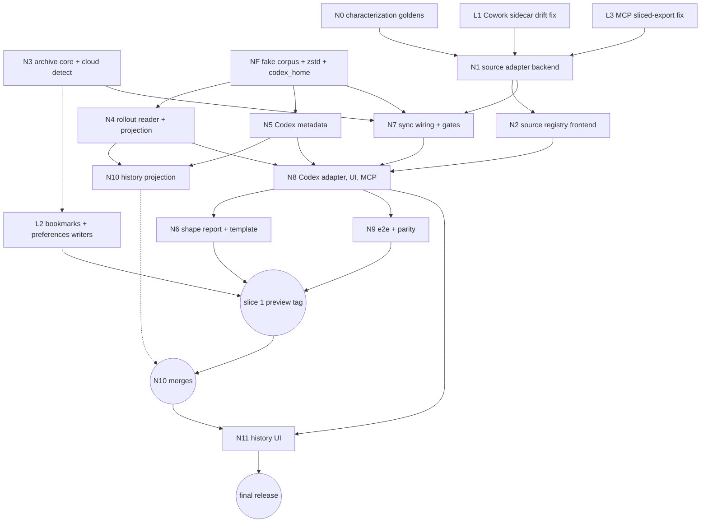

# Codex Source: Plan and Task DAG

- **Status:** version 2, ready for an orchestrator (2026-11-18). Version 1 is kept as [plan-v1.md](reviews/2026.11.18-codex-source/plan-v1.md), because the line numbers in the reviews refer to it. Three reviews studied version 1; their reports are in [reviews/2026.11.18-codex-source/](reviews/2026.11.18-codex-source/):
  - **EGM 0.1.1:** stages 5-9, 10 Claude reviewers.
  - **Ponytail 5.3.3:** `ultra` level.
  - **LLM Council:** Opus 5.5, `google/gemini-3.8-flash` through OpenRouter, `chatgpt/gpt-5.6-terra`.
- **Ticket:** [#37](https://github.com/rpeck/claude-explorer/issues/37). The user decisions are in its "Update 2026-11-18" section and in [council_report.md](reviews/2026.11.18-codex-source/council_report.md) ("User Decisions").
- **Companions:** Pi [#35](https://github.com/rpeck/claude-explorer/issues/35) and Hermes [#36](https://github.com/rpeck/claude-explorer/issues/36), two other agent tools whose sessions Explorer may show later. They reuse the source adapter from N1.
- **Readers:** the orchestrator, the coder sessions, and the tester sessions. Claude Code or Codex can run each role.
- **Labels:** "Nx" and "Lx" are the PRs in §6. "Dx" are decisions (§2).

## 1. Why

The user now does most coding work in OpenAI Codex. Explorer cannot show those sessions today. The user cannot search them, export them, or ask the MCP tools about them.

This plan adds Codex as a fourth source in the web UI and in the MCP server. It also keeps a copy of every Codex rollout in the Explorer archive. If Codex loses a file, the history stays.

The work has three slices:

- **Slice 0 (foundation):** a source adapter and a safe archive copier. A user sees no change.
- **Slice 1 (preview release):** Codex sessions appear in the list, the viewer, search, export, and MCP. A session whose history slice 1 cannot rebuild shows an "incomplete" notice.
- **Slice 2 (full history):** compaction, revert, forks, subagents, and prefix references show correctly.

### 1.1 Goals: the #37 acceptance criteria and their nodes

| # | Acceptance criterion (#37) | Nodes |
|---|---|---|
| AC1 | Plain and `.zst` rollouts show under Codex, with title, project, archive state, times, and model | N4, N5, N8 |
| AC2 | E2E: source and project filter, search, jump, detail controls, copy, Markdown, PDF; docs updated | N8, N9 |
| AC3 | All 5 MCP tools work, and the UI and MCP agree | N7, N8, N9 |
| AC4 | Tests for both history modes, duplicates, snapshots, parallel tools, compaction, revert, forks, missing or cyclic bases | N4 (slice 1), N10 (slice 2) |
| AC5 | Tests for both file forms, a missing or locked `state_5`, name updates, damaged lines, media, path containment, stable ids | N3, N4, N5 |
| AC6 | No Codex file changes; a missing install is harmless; an unsupported format gives a warning | N5, N8 |

### 1.2 Non-goals

- No Codex runtime, plugin, or daemon integration.
- No cloud fetch. Cloud-only Codex conversations are out of scope.
- No write-back and no session capture.
- No reading of `history.jsonl`, logs, credentials, or `thread_history_1.sqlite`.
- **No Explorer process writes, renames, locks, creates, or opens for writing any file or folder under a Codex home.** No process launches or resumes Codex, or migrates its databases.
- The local Claude Code and Cowork archive gap (CLAUDE.md principle 2) is out of scope. N3 is generic, so that gap can be its next user.
- **No new upload path.** The cloud-sync gate (D13) stops every Explorer writer that puts work data into a cloud-synced folder. It does not stop the cloud client itself.
- **D5 replaces the #37 non-goal "no always-on watcher".**

## 2. Decisions

| # | Decision | Source | Reason |
|---|---|---|---|
| D1 | Copy every Codex rollout into the Explorer archive. Never delete an archived copy. | User | CLAUDE.md principle 2. |
| D2 | A session with any turn stays visible. Do not hide a session because `has_user_event` is false, or because a field is missing. | User | Principle 1. `has_user_event` is 0 for all 66 local threads, so a test on it would hide every session. |
| D3 | Add a source adapter first. Port the three current sources with no change in behavior. | User | Pi and Hermes follow. |
| D4 | Add `zstandard` (for Python < 3.14), also in the MCPB bundle. | User | Python 3.14 has `compression.zstd`. |
| D5 | The watcher, Refresh, the CLI, and MCP all copy. They never collide, also across processes. | User | An MCPB-only user has no `serve` and no watcher. |
| D6 | The rollouts are the source of truth. Read `state_5.sqlite` for metadata only, and keep a snapshot of it in the archive. | Derived | `thread_history_1.sqlite` is a cache that Codex builds from the rollouts. |
| D7 | Every reader (list, viewer, search, export, MCP) reads the archive copy. Only the copier and the read-only shape report (N6) read a Codex home. | Derived | One read path; D1 holds when Codex loses a file. |
| D8 | The conversation `uuid` is the Codex thread `id`. The UI and MCP also show the Codex session name and the Codex home. | User | The user can paste the id into `codex resume <id>`. |
| D9 | The copier is a writer. It obeys the corrupt-config gate in every caller. The gate skips only the copy: image capture and the drift pass still run. | Derived | A corrupt config can point to the wrong `data_dir`. While no pruning code exists in Codex (§3), a skipped copy loses no data. |
| D10 | Tests use only synthetic Codex data. Real corpora stay on work machines (§9). | User | Privacy. |
| D11 | A slice 1 preview release comes before slice 2 (§6.3). | User (U1) | The user needs to see Codex sessions soon. |
| D12 | The copier appends new rollout bytes under the lock. It replaces only the small JSON files whole. | User (U3) | A replace fails on Windows while a reader has the file open, and each replace rewrites the whole file. |
| D13 | No Explorer writer puts data into a cloud-sync folder until the user opts in twice (§4.3). The gate covers every source, not only Codex: the Codex copy, the Desktop fetch, the remote Cowork sync, the search index and summary cache, and Claude Code image capture. While the gate is closed, images wait in a local pending folder. | User (U2, Q1, 2026-11-18) | Work transcripts must not reach a cloud service by accident. Images must not be lost while the user decides. |
| D14 | The UI, the exports, and MCP show the Codex home as `~/...`. The UI copy button and `home.json` keep the absolute path. | User (U4) | The user name does not reach a model. |
| D15 | When MCP finds the lock busy, it reads the archive as it is and returns `sync_pending: true`. | User (U6) | The client knows that the data can be a few seconds old. |
| D16 | A release needs every `codex-verification` issue closed as fixed, plus at least one passing work-machine report. | User (U5) | No release with a known bug. |
| D17 | N5 reads `state_5` from a checked private copy. No SQLite connection ever opens a file in the Codex home. | Derived (council N5, 2026-11-19, unanimous; [council_n5_state_db.md](reviews/2026.11.18-codex-source/council_n5_state_db.md)) | A SQLite reader creates `-wal` and `-shm` in a clean Codex home (§1.2). `immutable=1` returns stale and torn rows while Codex writes. |
| D18 | Slice 1 maps every item type and record kind of Codex 0.170 that the first work report showed (`McpToolCall`, `FileChange`, `CollabAgentToolCall`, `SubAgentActivity`, `ImageView`, `Extension`, and `inter_agent_communication`), as tool calls that Show Tools hides and shows. | User (2026-11-19, after #70) | The first work report had 387 unsupported items and 14 of 21 sessions incomplete from one unknown record kind. |

**Change rule:** change a "User" decision only with the user. A "Derived" decision can change if the orchestrator records why.

### 2.1 Alternatives considered

| Choice | Rejected option | Reason |
|---|---|---|
| Readers use the archive only (D7) | Read `~/.codex` live, and keep the archive as a backup | Two read paths, and sessions disappear when Codex loses a file. |
| Store decoded JSONL | Copy the `.zst` or plain bytes as they are | The form of a file changes (§3). Decoded content only grows, so an append works (D12). |
| Append rollouts (D12) | A temp file plus an atomic replace | A replace fails on Windows during a read, and each pass rewrites the whole file. GPT preferred this option; the user chose to append. |
| A per-home lock for all callers | One writer (the watcher), which the others signal | An MCPB-only user has no watcher. |
| The thread file is the change signal | A multi-file fingerprint in `indexed_files.mtime` | Old and new processes would reindex each other forever. With the thread file, every stat-keyed cache works unchanged. |
| A generic copier (N3) | Copy logic only for Codex | The Claude Code and Cowork gap can reuse it later. |

## 3. Codex Facts (checked 2026-11-18)

These facts come from the local `~/.codex` (codex-cli 0.164.0, metadata only) and from `openai/codex` at commit [`f2d3086`](https://github.com/openai/codex/tree/f2d3086682a848e9121c5f688cf1d77ad5d2a114).

- **Corpus:**
  - `sessions/` holds 2 plain and 35 `.jsonl.zst` rollouts.
  - `archived_sessions/` holds 33 plain rollouts.
  - `state_5.sqlite` lists 66 threads: 65 `paginated` and 1 `legacy`.
  - The corpus is 17.5 MB compressed. The largest file is 2.2 MB compressed.
  - The counts change daily: about 30 threads moved to `archived_sessions/` between 2026-11-17 and 2026-11-18.
- **Codex changes the form of a file.** See [`compression.rs`](https://github.com/openai/codex/blob/f2d3086682a848e9121c5f688cf1d77ad5d2a114/codex-rs/rollout/src/compression.rs):
  - It compresses a plain rollout older than 7 days into `.jsonl.zst` and deletes the plain file.
  - When the thread resumes, it decompresses it to `.jsonl` and deletes the `.zst` file.
  - Archiving moves the file to `archived_sessions/`.
  - The content stays the same in each case. Only the path changes, so the physical key is the file stem (`rollout-<timestamp>-<id>`).
- **No pruning:** no code in `openai/codex` deletes old rollouts.
- **`session_index.jsonl`:** an append-only name index with `id`, `thread_name`, and `updated_at`. The last line for an `id` wins.
- **`state_5.sqlite.threads`:**
  - **Columns used:** `id`, `rollout_path`, `title`, `name`, `archived`, `cwd`, `git_sha`, `git_branch`, `git_origin_url`, `model`, `history_mode`, `updated_at_ms`, `thread_source`, `source`.
  - **`thread_source` values:** `user`, `subagent`, `guardian_review`, and NULL. A subagent's `source` JSON holds `parent_thread_id`.
  - **A read-only open failed once** ("unable to open database file") while Codex closed the database. A retry worked.
  - **A SQLite reader leaves files.** In a home with no `-wal` and no `-shm`, `sqlite3.connect("file:...?mode=ro", uri=True)` creates `state_5.sqlite-wal` (0 B) and `state_5.sqlite-shm` (32 KiB) and leaves them after it closes. `immutable=1` creates nothing, but it misses WAL commits and returns torn rows or "malformed" while Codex writes. (Council N5, 2026-11-19, SQLite 3.47.1.)
- **`session_meta` Git metadata** holds only `commit_hash`, `branch`, and `repository_url`, not a root path. See [`protocol.rs`](https://github.com/openai/codex/blob/f2d3086682a848e9121c5f688cf1d77ad5d2a114/codex-rs/protocol/src/protocol.rs), `GitInfo`.
- **Item types:** completed items have 19 types (`ThreadItemPayload` in [`v2/item.rs`](https://github.com/openai/codex/blob/f2d3086682a848e9121c5f688cf1d77ad5d2a114/codex-rs/app-server-protocol/src/protocol/v2/item.rs)):
  - **Mapped in slice 1:** `UserMessage`, `AgentMessage`, `Reasoning`, `CommandExecution`.
  - **Marks the session incomplete:** `ContextCompaction`.
  - **The other 14:** `HookPrompt`, `FunctionCallOutput`, `Plan`, `FileChange`, `McpToolCall`, `DynamicToolCall`, `CollabAgentToolCall`, `SubAgentActivity`, `WebSearch`, `ImageView`, `Sleep`, `ImageGeneration`, `EnteredReviewMode`, `ExitedReviewMode`.
- **Imported sessions:** `external_agent_session_imports.json` lists each Claude Code session that Codex imported. Each record has `source_path`, `content_sha256`, and `imported_thread_id`.
- **Python:** `compression.zstd` is in the standard library from 3.14. The project supports 3.11 and later, and `compression` is not a standard-library name on 3.13.

## 4. Design

### 4.1 Source adapter (N1, N2)

Today the three sources are wired by hand:

- `Literal["CLAUDE_AI", "CLAUDE_CODE", "CLAUDE_COWORK"]` in about 25 signatures
- source branches in `backend/store.py`, `backend/search_index.py`, and `backend/cc_watcher.py`
- hard-coded rules in 11 frontend files

The three sources are `CLAUDE_AI` (Claude Desktop and claude.ai chats), `CLAUDE_CODE` (Claude Code sessions), and `CLAUDE_COWORK` (local Cowork sessions and remote Cowork tasks).

**Backend package `backend/sources/`:**

- **`ids.py`:**
  - `SourceId = Literal[...]` and `SourceFilter = Literal["all", ...]`.
  - Every other module imports them.
  - A test asserts that the members of `SourceId` equal the registry keys.
- **`base.py`:** the `SourceAdapter` protocol and the `SourceDescriptor` dataclass.
- **`registry.py`** (decided by the N1 council, 2026-11-19; see [council_n1_adapter.md](reviews/2026.11.18-codex-source/council_n1_adapter.md)): `register_adapter(descriptor, factory)`, `get_descriptors()`, `get_descriptor(source_id)`, `get_adapters(store)`, `get_adapter(source_id, store)` (`KeyError` for an unknown id), `get_adapter_or_none(source_id, store)`, and `reset_for_tests()`.
  - Each factory takes the `ConversationStore`. The roots come from the store, never from the settings.
  - Registry order is behavior: `CLAUDE_AI`, `CLAUDE_CODE`, `CLAUDE_COWORK`, then `CODEX`.
  - A test registers a fake adapter through a fixture. The `SourceId` parity test runs after `reset_for_tests()` only.
- **`claude_ai.py`, `claude_code.py`, `cowork.py`:** thin ports (`ClaudeAiAdapter`, `ClaudeCodeAdapter`, `CoworkAdapter`). Each holds its store and calls store methods; the per-source code stays in `store.py` as bridge methods, so every existing test patch point keeps working. Moving that code into `backend/sources/` is a later node (after N8) that owns the test files that bind to store internals.

**`SourceDescriptor` fields:**

| Field | Meaning |
|---|---|
| `id`, `label`, `short_label` | For example `CLAUDE_CODE`, "Claude Code", "Code" |
| `chronological` | No branch tree; messages are in file order |
| `has_projects` | Project grouping and the project and path filters apply |
| `has_archive_state` | The Archived toggle applies |
| `has_organizations` | The workspace filter applies |
| `refetchable` | The Re-download button applies |
| `messages_change_in_place` | A message can change without a change in the count. The MCP outline cache then rebuilds in full. |

The descriptor has exactly these fields, and it is a frozen dataclass. Backend-only rules are adapter methods.

**The Codex descriptor (N8):**

| Field | Value |
|---|---|
| `id` | `CODEX` |
| `label` | "Codex" |
| `short_label` | "Codex" |
| `chronological` | `True` |
| `has_projects` | `True` |
| `has_archive_state` | `True` |
| `has_organizations` | `False` |
| `refetchable` | `False` |
| `messages_change_in_place` | `True` |

Archived Codex sessions are hidden by default, as Cowork sessions are.

**`SourceAdapter` methods:**

- `descriptor() -> SourceDescriptor`
- `watch_roots() -> list[WatchRoot]` (the adapter is bound to a store)
  - Each `WatchRoot` has a path, file-name patterns, and a `create: bool` flag.
  - The current sources keep `create=True`. Codex uses `create=False`.
- `discover() -> Iterable[Path]`: the conversation files, which the index stores as `indexed_files.path`.
- `list_rows(*, full_content: bool, include_phantom: bool) -> list[dict]`: each adapter writes its own. The three ports return today's per-source rows, in today's order. A session with no turns has no row (D2).
- `find(uuid) -> tuple[dict, Path] | None`: for the viewer, export, and MCP; it may use caches.
- `load_for_index(path) -> dict | None`: the raw dict for the search index (§4.5); it reads Claude Code and Cowork uncached, as the index does today.
- `branch_flag(data, chat_messages) -> bool`: the backend-only branch rule (Claude Code returns `False`).
- `archive_sync(ctx: SyncContext) -> SyncReport | None`: `None` for a source that copies nothing yet.

**The sync types** (`backend/archive_sync.py`, N3):

- **`SyncContext`:** `settings`, `reason` (`"watcher"`, `"backstop"`, `"refresh"`, `"cli"`, or `"mcp"`), and `lock_timeout_s`.
- **`SyncReport`:**
  - `wrote_any: bool`
  - `skipped_reason`: `None`, `"busy"`, `"timeout"`, `"corrupt_config"`, `"cloud_sync_gate"`, or `"no_home"`
  - `warnings: list[str]`
  - `counts`: copied, unchanged, appended, revisions, and decode errors

**Frontend (N2):**

- **The generated file:** N1 writes `frontend/src/lib/sources.generated.json` from the registry with `scripts/generate_sources_json.py`.
  - `scripts/check.py` runs the generator in its `python` section and fails on a diff.
  - The UI imports the file at build time. There is no run-time endpoint.
  - N1 sets `resolveJsonModule` in `frontend/tsconfig.app.json`.
- **The presentation map:** `SOURCE_PRESETS` in `frontend/src/components/conversation/SourceBadge.tsx` keeps the icon, label, and color for each source. A vitest test fails if a source has no preset.
- **Rules that N2 changes to read the flags:**
  - the filter items in `Sidebar.tsx`
  - the group-by-project toggle and the Archived toggle (`Sidebar.tsx`)
  - `groupingApplies`, `folderName`, and the project-path collection (`conversationListView.ts`)
  - the group badge and the project label (`ConversationList.tsx`)
  - the project-path gate (`ConversationHeader.tsx`)
  - Re-download (`ConversationToolbar.tsx`)
  - `SOURCE_FILTERS` and the inline source unions (`types.ts`, `api.ts`, `useConversations.ts`, `MessageBubble.tsx`)
- **Bookmarks:** no change. The bookmark `source` field has no reader, and a Codex bookmark is stored as `claude_code`.

**The rule for N1: no change in behavior.**

- N0 records goldens of these outputs for the three sources:
  - the list
  - the viewer
  - search
  - Markdown export
  - the 5 MCP tools: `list_sessions`, `list_projects`, `get_session_outline`, `get_messages`, `export_session`
- N1 keeps them identical after normalization (§6.1, N0).
- A golden may change only for a bug fix that has its own test, and only through its own leaf PR (L1, L3).

### 4.2 Archive layout and copy rules (N3, N7, N8)

```text
<data_dir>/codex/<home_key>/home.json                  # schema below
<data_dir>/codex/<home_key>/.sync.lock                 # ArchiveLock file
<data_dir>/codex/<home_key>/rollouts/<stem>.jsonl      # decoded rollout; grows only
<data_dir>/codex/<home_key>/rollouts/<stem>.meta.json  # schema below
<data_dir>/codex/<home_key>/rollouts/<stem>.rev-<n>.jsonl  # diverged copy, n = 1, 2, ...
<data_dir>/codex/<home_key>/threads/<thread_id>.json   # conversation file; schema below
```

- **The home key:**
  - Resolve the Codex home path with `realpath`.
  - On macOS and Windows, fold the case.
  - `home_key` is the first 12 hex characters of its SHA-256.
- **Validation:** validate `<stem>` and `<thread_id>` with strict patterns before you use them in a path. Check that each final path stays inside `<data_dir>/codex/`.
- **One home copies; all homes read.** The copier syncs the one home in `Settings.codex_home` (§4.3). Readers read every `<home_key>` tree.
- **Unsupported:** a `data_dir` that two machines share.

**File schemas.** Each JSON file has `"version": 1`. A reader skips a file with a higher version and logs a warning.

| File | Fields |
|---|---|
| `home.json` | `version`, `home_path` (absolute), `first_seen_ms` |
| `<stem>.meta.json` | `version`, `stem`, `thread_id`, `copied_bytes`, `source_path`, `source_size`, `source_mtime_ns`, `last_sync_ms` |
| `threads/<thread_id>.json` | `version`, `thread_id`, `home_key`, `source_name`, `title`, `cwd`, `model`, `archived`, `history_mode`, `thread_source`, `parent_thread_id`, `imported_from` (Claude Code source path or `null`), `rollouts` (list of `{stem, copied_bytes, session_meta_ts_ms}`), `current_stem`, `current_ambiguous`, `updated_at_ms` |

**Copy pass for one home.** N3 owns the generic steps. N8 owns the Codex parts (marked "Codex").

1. If the Codex home does not exist, stop. Create nothing (§1.2).
2. For each rollout stem (Codex: `sessions/**` and `archived_sessions/**`, both `.jsonl` and `.jsonl.zst`; if both forms exist, read the plain file):
   1. If `source_size`, `source_mtime_ns`, and `source_path` equal the meta file, skip to the next stem.
   2. Decode the source as a stream. On a decode error, keep the archive as it is, log a warning, and retry on the next pass. **A decode error never makes a revision.**
   3. Do not copy a last line that has no newline. Codex can still write to it.
   4. If the decoded source is a prefix of the archive copy (a short read), change nothing.
   5. If the archive copy is a prefix of the decoded source, append the new bytes, then `fsync`.
   6. Else the source diverged. Make a revision only after a complete decode whose bytes differ from the newest revision:
      - rename the copy to the next free `.rev-<n>`;
      - write the new copy;
      - log a warning.

      Never delete.
   7. Write `<stem>.meta.json`.
3. **Run this step on every pass, also when no rollout changed (Codex).** For each thread:
   - read `session_index.jsonl`, `state_5`, the session-import list, and the `session_meta` of each rollout;
   - build the thread JSON;
   - write it only when its bytes differ.

   Thus a rename or an archive change in Codex reaches the archive.
4. If the pass wrote anything, schedule the existing drift single-flight. The drift pass finds the changed thread files by mtime.

**Write rules:**

- **Rollout copies only grow.** They are appended under the lock (D12). Readers ignore a last line that has no newline.
- **The JSON files are replaced whole** with `fetcher.atomic.atomic_write_bytes`: a temp file in the same folder, then `fsync`, then `atomic_replace` with its Windows retry.
- **A crash between the data write and the metadata write** needs no repair code. Step 3 on the next pass repairs it.

**The current rollout and "newest"** (Codex):

- **`current_stem`:** the stem of `state_5.rollout_path`, if it is inside the home. Else, the rollout with the newest `session_meta` timestamp.
- **`current_ambiguous: true`:** the thread has more than one rollout, and `state_5` has no valid row for it.
- **Newest copy of a thread id across homes:** the largest `updated_at_ms`. If a copy has none, use its newest `session_meta` timestamp. A tie goes to the smaller `home_key`. Every process computes it the same way, and `discover()` dedupes once with it.

**List summaries (N8):** a per-process dict keyed by the thread file's `(mtime, size)` caches each Codex list row. It follows the `_cowork_summaries` pattern in `backend/store.py`.

### 4.3 Callers, locks, and gates (N3, N7, N8)

**The callers:**

- the watcher (event pass and backstop `scan_once`), in `serve` or in the supervised process
- Refresh and `/fetch/start`, in `serve`
- `claude-explorer fetch` (CLI)
- each MCP server process (there can be many)

**`ArchiveLock` in `backend/archive_sync.py`:**

- A module `threading.Lock` for each home, plus a portalocker exclusive lock on a fresh handle of `<home_key>/.sync.lock`.
- It writes no holder metadata. The OS releases the lock of a process that dies.
- `backend/archive_sync.py` imports neither `backend.cc_watcher` nor `backend.deps`: the MCP closure forbids both.

**Policy for each caller:**

| Caller | Lock | When busy or timed out |
|---|---|---|
| Watcher event pass, backstop | Try with no wait, at the top of `_event_drift_pass` and `_backstop_drift_pass`, inside the existing drift single-flight | Call `_schedule_drift(...)` to try again after the debounce |
| Refresh, `/fetch/start` | Wait up to 60 s in a worker thread, off the event loop | Send a `progress` frame with `phase: "codex"` and the message, skip the copy, and continue with the claude.ai fetch |
| CLI `fetch` | Same as Refresh. The hook is in `cli/main.py`, **before** the credentials load, so a user without credentials can still copy. | Print the message, skip, continue |
| MCP tool call | One inline pass with no wait, at most once per debounce interval per process. No thread and no timer. | Read the archive as it is. `list_sessions` and `get_session_outline` return `sync_pending: true` (D15). |

**Gates.** Each copy pass checks both gates, in this order:

1. **Corrupt config (D9):** call `get_settings.cache_clear()`, then read `config_corrupt_reason`. If it is set, skip the copy and log one WARNING line.
2. **Cloud sync (D13):** detect a write target inside a cloud-sync folder. The full detection rule is in [council_report.md](reviews/2026.11.18-codex-source/council_report.md) ("U2 Rule"). The user widened its scope to every source (Q1).
   - **Detection:**
     - Resolve each write target with `realpath`: `data_dir` and its siblings `search-index.sqlite` and `cc-images/`.
     - A target counts as cloud-synced if it is under one of these:
       - iCloud Drive (`~/Library/Mobile Documents/`, `%USERPROFILE%\iCloudDrive`)
       - a Dropbox root (`info.json`, `~/Dropbox`)
       - a OneDrive root (`OneDrive*` env vars, `~/OneDrive*`)
       - a Google Drive root
       - `~/Library/CloudStorage/`
     - If detection cannot decide, the folder counts as cloud-synced.
     - Detection is best effort. UX.md and the README say so.
   - **Opt-in:** both of these:
     - `allow_writes_in_cloud_sync` in `config.json`, whose value is the resolved `data_dir`, so a moved folder closes the gate again;
     - a three-step UI confirmation: a warning that names the provider, a check box, and the typed provider name.
   - **The route:** the UI writes the flag only after step three, through a POST route. The route has a custom header, an Origin check, and the corrupt-config gate.
   - **What each writer does while the gate is closed:**

     | Writer | While closed |
     |---|---|
     | Codex copy | Skips the pass. |
     | Desktop fetch, remote Cowork sync (Refresh, `/fetch/start`, single re-fetch, `claude-explorer fetch`) | Refuses before any network call, with a message that names the folder and the provider and points to the consent dialog. The routes return HTTP 409 with that message. |
     | Search index and summary cache | Write nothing. Search uses its existing linear-scan fallback, and list summaries are not cached. |
     | Claude Code image capture | Writes to a local pending folder (below). It never skips an image. |

   - **The pending image folder:**
     - It is `~/.claude-explorer/cc-images-pending/`. If that path is itself cloud-synced, use the platform cache folder (`platformdirs.user_cache_dir("claude-explorer")/cc-images-pending`). If that is cloud-synced too, keep capturing to it and log an ERROR, because a lost image cannot come back.
     - It keeps the same layout as `cc-images/`, so the viewer can serve an image from either folder.
     - After the opt-in, the next watcher pass moves each pending image into `cc-images/`: copy, `fsync`, check the size, then delete the pending copy. This is the only delete in the plan, and it removes a copy only after the image is safe in the archive.
   - **Users who already keep their data in a cloud folder:** the gate closes for them too, on the first start after the upgrade. A persistent banner (like `ConfigCorruptionBanner`) explains the change and opens the consent dialog. The data that is already there stays.
   - **Other callers only report the closed gate:**
     - The watcher logs one WARNING line per pass.
     - The CLI prints the folder and how to allow the writes.
     - MCP `list_sessions` returns a notice. That notice is not `sync_pending`.
   - **Before the dialog exists:** N7 lands the gate and the route; N8 adds the dialog and the banner. Between them, a developer opts in with the config flag. No release happens between N7 and N8.
   - **Revoke:** delete the flag. Existing data stays (D1).

**Watch roots (N7):**

- Codex roots use `create=False`.
- A missing root is skipped, and the backstop checks again.
- The Codex patterns match `*.jsonl`, `*.jsonl.zst`, `session_index.jsonl`, and `state_5.sqlite*`.

**The Codex home setting (NF):**

- `Settings.codex_home` reads the `CODEX_HOME` env var, then `codex_home` in `config.json`, then `~/.codex`. This is the same pattern as `claude_dir`.
- Every process reads it the same way. The supervised watcher has no shell environment, so `config.json` is the reliable place.

### 4.4 Codex projection (N4, N5, N10)

**N4 (rollout fields only):**

- **History mode:** paginated if `state_5.history_mode` says so. Else, paginated if the rollout has any `event_msg/item_completed` record. Else legacy.
- **Paginated history:**
  - A later snapshot of an item replaces the earlier one, keyed by (turn id, item id).
  - The mapping of item types:

    | Item type | Becomes |
    |---|---|
    | `UserMessage` | a human message |
    | `AgentMessage` | an assistant text block |
    | `Reasoning` with a readable summary | a `thinking` block |
    | `CommandExecution` | a `tool_use` block and a `tool_result` block |
- **Legacy history:**
  - `response_item/message` becomes a message.
  - A tool call matches its output by `call_id`, never by position.
  - Decode arguments that are JSON text inside a string.
- **Both modes skip these records:** developer instructions, injected environment text, tool declarations, `world_state`, and `token_usage_record`. In paginated history, `response_item` is skipped too.
- **Any other item type** becomes a fallback block labeled with its type name, and adds one warning.
- **Encrypted reasoning** shows "Encrypted reasoning (not readable)". Never decrypt it.
- **Media:** a label for each image reference. Never fetch a URL, and never open a file at a path that a record names.
- **Damaged lines** are skipped and counted as warnings.
- **The model** comes from `turn_context` for each turn. The session model is the model of the last turn.
- **The project** is the `cwd` from `session_meta`.
- **The incomplete classifier (slice 1).** These records set `incomplete` with a reason:
  - `compacted` and `ContextCompaction`
  - rollback and revert
  - `history_base`
  - `current_ambiguous`
  - an unknown record type that can change the history

  A fork or subagent without `history_base` is not incomplete; only its link is missing.

**N5 (metadata):**

- **`source_name`:** the `session_index.jsonl` name, else `state_5.name`, else `None`.
- **Title:** `source_name`, else `state_5.title`, else the first human message, else "Codex session <date>".
- **`archived`:** `state_5.archived` if the row exists, else `true` when the rollout is under `archived_sessions/`.
- **`state_5` access (D17):**
  - Open only `state_5.sqlite` and, when present, `state_5.sqlite-wal`, read-only. Never open `-shm`, and never give SQLite a path in the Codex home.
  - Copy them into a private temp folder (mode 0700, in the system temp folder, never `data_dir`), and open the copy.
  - Accept the copy only if every check passes: two reads of the main file are equal; the main file and the WAL keep their identity; the WAL salts at the start, in the copy, and at the end are equal; and no `-journal` exists. Then `quick_check` and the column check must pass.
  - Make up to 3 attempts in 250 ms in total. Do not copy more than 64 MiB.
  - Never wait on it in discovery.

  If it is missing, too large, changing on every attempt, or has an unknown schema, add a warning, and keep each thread's last archived `state_5` values. Use `session_meta` and the title chain only for a thread with no archived values. If the rollout set of a thread changed since those values, set `current_ambiguous: true`.
- **Parent links:** subagent parents come from `thread_source` and the `source` JSON.
- **The imported-from-Claude-Code flag** comes from `external_agent_session_imports.json`.

**N10 (slice 2):**

- Compaction becomes a `CompactMarker`. The replacement context is not a turn.
- Rolled-back turns are hidden.
- Forks and subagents link through `parent_uuid`.
- `history_base` prefix references are followed up to 32 links, with cycle and missing-base detection.
- When N10 can rebuild a history, it clears `incomplete`.

**The Codex projection version (N8):**

- The constant `CODEX_PROJECTION_VERSION` lives in `backend/sources/codex.py`.
- The search index stores it in its meta table, as an additive key with no `SCHEMA_VERSION` bump.
- At startup, a different value marks the Codex rows of `indexed_files` stale. The drift pass then reindexes them, and N10's changes reach search.

### 4.5 Output fields (N4, N8)

**The raw dict from `load`** keeps the current shape: `chat_messages`, `compact_markers`, and the summary fields.

**Codex message ids:**

- **Paginated:** a UUID5 of thread id, turn id, and item id.
- **Legacy:** a UUID5 of thread id and line number.

Thus a fork that reuses item ids never takes the rows of another session. The MCP outline cache keys on message ids globally.

**New optional fields on `ConversationSummary` and `ConversationDetail` (N8).** Other sources leave them `None`:

| Field | Meaning |
|---|---|
| `source_name: str \| None` | The name that Codex gave the session (§4.4) |
| `source_home: str \| None` | The Codex home, shown as `~/...` (D14) |
| `source_home_abs: str \| None` | The absolute path, for the UI copy button only. MCP does not return it. |
| `notices: list[str]` | The warnings count, "incomplete: <reason>", "ambiguous current rollout", "Imported from Claude Code", the cloud-sync gate notice, and "N older rollouts are kept in the archive" |
| `parent_uuid: str \| None` | The parent thread of a subagent or fork |

**The web UI header:**

- "Thread ID", "Codex name" (or "none"), and "Codex home".
- Each has a copy button (`CopyValueButton.tsx`), and the paths use `displayPath`.
- The `notices` show above the messages.

**MCP:**

- `list_sessions` and `get_session_outline` return `source_name`, `source_home`, `notices`, and `sync_pending`.
- `export_session` and the UI Markdown export put the thread ID, the Codex name, and the Codex home in the export header.

### 4.6 Dependencies and the MCPB bundle (NF, N7, N8)

- **`pyproject.toml`:** `zstandard>=0.23; python_version < "3.14"` (NF).
- **`backend/codex/zstd.py`:** imports `compression.zstd` inside a function on 3.14+, else `zstandard`.
  - The closure analyzer does not see this lazy import.
  - Thus N8 lists `zstandard` explicitly in the bundle's stripped `pyproject.toml`, with the same marker.
  - N8 updates `EXPECTED_EXTERNAL_DEPS` to match the analyzer's result.
- **N7:** adds `portalocker` to `EXPECTED_EXTERNAL_DEPS` and to the stripped `pyproject.toml`, because `archive_sync` reaches the MCP path in N7.
- **N8:**
  - adds `backend.sources.codex`, `backend.codex.*`, and `backend.archive_sync` to `DYNAMIC_IMPORT_MODULES` wherever the import is lazy;
  - updates `mcp_server/tests/test_build_mcpb.py`, the MCPB section of `CLAUDE.md`, and `assets/mcpb-README.md`.
- **The closure canary** (`mcp_server/tests/test_mcpb_closure.py`) stays as it is.
- **A smoke test** (N7, extended in N8) builds the bundle and imports it in isolation. In N8 it runs `archive_sync` against a fake home.

## 5. Tests that protect privacy and the Codex home

- **NF:** an autouse fixture in `backend/tests/conftest.py` and `mcp_server/tests/conftest.py` points `CODEX_HOME` at an empty temp folder. It works like `_isolate_cowork_app_dir`. **No test reads a real `~/.codex`.**
- **N5:** reading `state_5` changes no file in the fake home. A hash of every file (name, size, mtime, content) is the same before and after the read: with no writer, with an idle live writer, and after a crashed writer. No `-wal` or `-shm` file appears. A replay of a checkpoint and a WAL restart during the copy never gives a state that Codex did not commit.
- **N8:** a hash of every file in the fake home before and after a full sync shows no change (AC6). No folder appears in a missing home.
- **N3:** the cloud-sync detection for each provider pattern and for a symlink into a cloud root.
- **N7:** with a cloud-synced `data_dir` and no opt-in, no writer adds or changes a file under `data_dir` or its siblings. A new Claude Code image lands in the pending folder, and it moves into `cc-images/` after the opt-in with the same bytes.
- **N8:** the consent dialog writes the flag only after its third step, and the banner shows for an existing cloud-synced `data_dir`.
- **N6:** the shape report has no message text, no path, no title, and no id.

## 6. Task DAG

Each node is one PR to `main`.

- A node starts when all its dependencies are merged.
- The waves below follow from the DAG. They are not barriers.



| Wave | Nodes |
|---|---|
| 1 | L1, L3, N0, N3, NF |
| 2 | N1, N4, N5, L2, L4 |
| 3 | N2, N7, L5, N10 (built now; merges only after the slice 1 tag) |
| 4 | N8 |
| 5 | N6, N9 |
| Gate | Slice 1 preview tag (§6.3) |
| 6 | N10 merges, N11 |
| Gate | Final release (§6.3) |

### 6.1 Nodes

**Ownership rules:**

- **Owns** lists the only files that a node may change. "New" marks a new file.
- A note in parentheses limits the change to that part of the file.
- If a node needs another file, it stops and reports to the orchestrator.
- Every node also owns its own new test files, named in the row.

| Node | Branch | Owns | Done when (each item has a test) |
|---|---|---|---|
| **L1** Cowork sidecar drift | `fix/cowork-sidecar-drift` | `backend/search_index.py` (Cowork drift only), new `backend/tests/test_cowork_sidecar_drift.py` | A change to a Cowork sidecar alone causes a reindex. Old and new processes do not reindex each other. |
| **L3** MCP sliced export | `fix/mcp-sliced-export-fields` | `mcp_server/server.py` (`export_session` only), new `mcp_server/tests/test_export_slice_fields.py` | A sliced `export_session` keeps every field. It uses `model_copy(update={"messages": ...})`. |
| **N0** goldens | `test/source-characterization` | new `backend/tests/test_source_characterization.py`, new `mcp_server/tests/test_source_characterization.py`, new `backend/tests/goldens/**` (a remote Cowork fixture included) | Goldens cover the outputs of §4.1 for all three sources, on the FTS search path plus one linear-scan case. Unsliced exports only (L3 owns the sliced ones). The tests replace temp paths, mtimes, and `indexed_at` values with fixed tokens. `UPDATE_GOLDENS=1` rewrites the goldens. The tests pass on `main`. |
| **N3** archive core | `feat/archive-sync-core` | new `backend/archive_sync.py`, new `backend/cloud_sync.py`, `fetcher/atomic.py`, `fetcher/remote_sessions.py` (write helper only), `backend/cc_image_cache.py` (write only), new `backend/tests/test_archive_sync.py`, new `backend/tests/test_cloud_sync.py` | `ArchiveLock`, `atomic_write_bytes`, and the generic steps of §4.2 work with a fake source. Each case has a test: short read, decode error, divergence, both file forms, a crash between writes. The 2-thread and 4-process tests pass on macOS and on the Windows VM. Cloud detection covers each provider. |
| **NF** fake corpus | `feat/codex-fake-corpus` | `pyproject.toml`, `uv.lock`, `backend/config.py` (`codex_home` only), `backend/tests/conftest.py` and `mcp_server/tests/conftest.py` (the Codex fixture only), new `backend/codex/__init__.py`, new `backend/codex/zstd.py`, new `backend/tests/codex_fake.py`, new `backend/tests/test_codex_fake.py` | The builder writes a synthetic Codex home. It has plain and `.zst` rollouts, `archived_sessions/`, `session_index.jsonl`, `state_5.sqlite` (§3 columns), and the imports file. It has paginated and legacy records, `turn_context`, damaged lines, encrypted reasoning, images, parallel `call_id`s, subagent and `guardian_review` threads, and an unknown item type. `uv sync` works on 3.11 to 3.15. |
| **N4** reader + projection | `feat/codex-rollout-reader` | new `backend/codex/rollout.py`, new `backend/codex/projection.py`, new `backend/tests/test_codex_projection.py` (it uses the NF builder; extra records go in this test file) | Each slice 1 rule in §4.4 (N4 part) and §4.5 (message ids) has a test, the incomplete classifier included. |
| **N5** metadata | `feat/codex-metadata` | new `backend/codex/home.py`, new `backend/codex/name_index.py`, new `backend/codex/state_db.py`, new `backend/codex/identity.py`, new `backend/codex/imports.py`, new `backend/tests/test_codex_metadata.py` (it uses the NF builder; extra records go in this test file) | Each N5 rule in §4.4, plus "newest" and `current_stem` (§4.2), has a test. A missing, oversized, changing, or unknown `state_5` falls back with a warning and keeps the archived values. A rejected copy is retried, up to 3 attempts. No file in the fake home changes. The 13 rules and 17 tests of [council_n5_state_db.md](reviews/2026.11.18-codex-source/council_n5_state_db.md) apply. |
| **L4** export filename | `fix/export-filename-encoding` | `backend/routers/export.py` (the `Content-Disposition` headers only), `backend/tests/test_source_characterization.py` (remove the one strict xfail only), `backend/tests/goldens/api/**` (record the one new golden only), new `backend/tests/test_export_filename.py` | A title with a non-Latin-1 character (an em dash, an emoji, CJK text) no longer makes the Markdown, Markdown-bundle, or PDF export fail with HTTP 500. Each route sends an ASCII `filename` fallback plus an RFC 5987 `filename*` with the UTF-8 name. The N0 strict xfail for the Claude Code Markdown export is removed, and its golden is recorded. Found by N0 on 2026-11-19; starts after N0. |
| **L5** Cowork branch flag | `fix/cowork-has-branches` | `backend/sources/cowork.py` (`branch_flag` only), `backend/store.py` (the Cowork branch rule only), `backend/tests/goldens/api/list.json` (the Cowork rows only), new `backend/tests/test_cowork_branch_flag.py` | Every Cowork list row with 2 or more messages reports `has_branches: true` today, although a Cowork session has no branches. `branch_flag` returns `False` for Cowork, and the golden is re-recorded. Found by the N1 council on 2026-11-19; starts after N1. |
| **L2** sibling writers | `fix/bookmarks-preferences-atomic` | `backend/routers/bookmarks.py` (`_write_all` only), `backend/routers/preferences.py` (`_write_atomic` only), new `backend/tests/test_atomic_writers.py` | Both writers use `atomic_write_bytes` (a unique temp name, `fsync`, the Windows retry). |
| **N1** adapter (backend) | `refactor/source-adapter-backend` | new `backend/sources/**`, `backend/store.py`, `backend/search.py`, `backend/search_index.py` (source plumbing only), `backend/models.py`, `backend/routers/conversations.py`, `backend/routers/search.py`, `backend/cc_watcher.py` (roots only), `mcp_server/server.py` (source plumbing only), `mcp_server/SPEC.md` (sources only, including §5 and §8), new `scripts/generate_sources_json.py`, `scripts/check.py`, `frontend/src/lib/sources.generated.json`, `frontend/tsconfig.app.json`, new `backend/tests/test_source_registry.py` | The N0 goldens do not change. `SourceId` and `SourceFilter` are defined once. The registry test passes. The generated JSON is checked in `check.py`. Every existing test passes, and N1 edits none of them. No code outside `backend/sources/` and the store's bridge methods compares a source id (the council report lists the exceptions). The registry order is `CLAUDE_AI`, `CLAUDE_CODE`, `CLAUDE_COWORK`. |
| **N2** registry (frontend) | `refactor/source-registry-frontend` | `frontend/src/**` except `frontend/src/lib/sources.generated.json` | Each rule in §4.1 reads a flag or a preset. vitest passes, and the N0 goldens do not change. Screenshots before and after show no difference. |
| **N7** sync wiring | `feat/archive-sync-wiring` | `backend/cc_watcher.py`, `backend/main.py` (lifespan only), `backend/routers/fetch.py`, `backend/models.py` (`phase` value only), `cli/main.py` (fetch hook only), `mcp_server/server.py` (sync hook and `sync_pending`), `mcp_server/SPEC.md` (§1, §8 write path, `sync_pending`), `scripts/build-mcpb.py` (portalocker only), `backend/search_index.py` and `backend/summary_cache.py` (cloud-sync gate only), `backend/cc_image_cache.py` (pending folder only), `backend/routers/files.py` (serve images from the pending folder only), new `backend/routers/write_consent.py`, `backend/config.py` (`allow_writes_in_cloud_sync` only), `UX.md` (Refresh and cloud-sync gate only), `CLAUDE.md` (gate and watcher lines only), new `backend/tests/test_archive_sync_wiring.py`, new `backend/tests/test_cloud_sync_gate.py`, new `mcp_server/tests/test_mcpb_smoke.py` | Every caller in §4.3 follows its policy row with a fake adapter. One test runs the watcher and a Refresh at the same time. The 60 s timeout path, the CLI without credentials, the gate order, and `sync_pending` each have a test. A root with `create=False` is never created. The bundle smoke test passes. Each writer in the §4.3 gate table behaves as its row says, and the §5 cloud-sync tests pass. The Cowork watch filter also reacts to a change of the session sidecar (`<session_dir>.json`), not only to `audit.jsonl` (a gap that L1 found; today a sidecar-only change waits for the backstop scan). |
| **N8** Codex adapter | `feat/codex-source` | new `backend/sources/codex.py`, `backend/sources/ids.py`, `backend/sources/registry.py`, `backend/models.py` (the §4.5 fields), `backend/search_index.py` (projection version only), `backend/main.py` (consent router only), `backend/exporters/markdown.py` (header only), `frontend/src/lib/sources.generated.json`, `frontend/src/lib/types.ts`, `frontend/src/components/conversation/SourceBadge.tsx`, `frontend/src/components/conversation/ConversationHeader.tsx`, new `frontend/src/components/conversation/NoticeList.tsx`, new `frontend/src/components/settings/CloudSyncConsentDialog.tsx`, new `frontend/src/components/layout/CloudSyncGateBanner.tsx`, `frontend/src/App.tsx` (banner only), `mcp_server/server.py` (instructions and §4.5 fields), `mcp_server/SPEC.md`, `mcp_server/tests/test_build_mcpb.py`, `scripts/build-mcpb.py`, `assets/mcpb-README.md`, `README.md`, `UX.md`, `CLAUDE.md` (MCPB section only), `pyproject.toml` (description only), new `backend/tests/test_codex_source.py`, new `mcp_server/tests/test_codex_mcp.py` | Codex works in each place: the list, the filter ("Codex"), project grouping, the Archived toggle, the viewer, search, copy, Markdown and PDF export, and all 5 MCP tools. The §5 privacy tests pass. The consent flow writes the flag only after its third step, and the banner shows while the gate is closed. The MCP text says "saved conversation history (Claude and Codex)". The detail cache (`_DETAIL_DICT_CACHE`, keyed by uuid only) cannot return a conversation of another source for the same uuid (keep the source or path in its key, with a test). N5's `thread_metadata` returns no `model`; N8 writes `model` into `threads/<thread_id>.json` from the N4 projection of the current rollout, and adds `version`, `home_key`, and `copied_bytes`. Every assistant message is labeled with the source's `assistant_label` ("Codex" for Codex) in the viewer, the branch tree, and the Markdown, PDF, and bundle exports. |
| **N6** shape report | `feat/codex-shape-report` | new `cli/codex_report.py`, `cli/main.py` (command only), new `.github/ISSUE_TEMPLATE/codex-verification.yml`, new `backend/tests/test_codex_report.py` | §9 output. It is read-only. A test proves that it has no message text, path, title, or id. |
| **N9** e2e + parity | `test/codex-e2e` | `scripts/generate_e2e_fixtures.py`, `backend/tests/fixtures/desktop/codex/**`, `backend/tests/fixtures/README.md`, new `frontend/e2e/codex-*.spec.ts`, `frontend/playwright.config.ts` (env only), new `mcp_server/tests/test_codex_parity.py`, `TESTING.md` (counts only) | The generator runs the real copier on a fake home. It then renames the home folder to the fixed key `fixture000000` and writes `home_path` as `/home/fixture/.codex`. In e2e, `CODEX_HOME` points to a missing folder, so nothing writes into the fixtures. The Playwright flow covers AC2 with zero console errors outside the §5.15 allowlist. The parity test shows that the web API and MCP return the same transcript, thread ID, Codex name, Codex home, and notices. |
| **N10** history (slice 2) | `feat/codex-history-projection` | new `backend/codex/history.py`, `backend/codex/projection.py`, `backend/sources/codex.py` (`CODEX_PROJECTION_VERSION` only), `backend/tests/codex_fake.py` (slice 2 record kinds only), new `backend/tests/test_codex_history.py` | Each slice 2 rule in §4.4 has a test. `CODEX_PROJECTION_VERSION` goes up. Merge only after the slice 1 tag. |
| **N11** history UI (slice 2) | `feat/codex-history-ui` | `frontend/src/components/conversation/**`, `backend/sources/codex.py` (`parent_uuid` and `notices` values only), `mcp_server/server.py` (outline links only), `UX.md` (Codex history only), new `frontend/src/components/conversation/__tests__/CodexHistory.test.tsx` | The viewer links forks and subagents to their parents and children. Notices update when N10 clears `incomplete`. |
| **N12** Codex 0.170 items | `feat/codex-items` | `backend/codex/projection.py`, `backend/sources/codex.py` (`CODEX_PROJECTION_VERSION` only), `cli/codex_report.py` (the known type sets only), new `backend/tests/test_codex_items.py` | Every 0.170 record kind is known. The six item types and agent messages map to tool calls (D18). `CODEX_PROJECTION_VERSION` goes up. Added after the first work report (#70); merged before the slice 1 tag. N10 rebases onto it. |

### 6.2 Windows tests

Run these on the ARM64 UTM VM before each push of the node:

- N3: `backend/tests/test_archive_sync.py`
- L2: `backend/tests/test_atomic_writers.py`
- N7: `backend/tests/test_archive_sync_wiring.py`

**How to run them:**

- Use the real `python.exe` with `sitecustomize.py` on `PYTHONPATH`.
- The VM has no git, so copy the code in with `git archive`.
- TESTING.md §7-§10 describe the VM. CI runs the full Windows suite on the PR.

### 6.3 Release gates

**Slice 1 preview:**

- N6 and N9 are merged.
- N6 ran on a work corpus, and its "incomplete" share is recorded in #37.
- Every `codex-verification` issue is closed as fixed (D16).
- At least one passing work-machine report exists.
- `uv run python scripts/check.py` passes on `main`.
- The Windows tests (§6.2) pass.
- The open bugs are listed in #37, and none is open.
- The CLAUDE.md pre-push checklist passes.
- The tag comes before N10 merges.
- The release notes say that the full history waits for slice 2. #37 stays open.

**Final release:** the same issue and check rules, after N10 and N11 merge.

## 7. Rules for the Orchestrator

- **Worktrees:** put each node at `~/Source/worktrees/claude-explorer/<branch>`, and its tester at `.../<branch>-tests` on branch `<branch>-tests`.
- **The coder and the tester run in separate sessions:**
  1. The tester writes failing tests on `<branch>-tests`.
  2. The coder works on `<branch>`, and never sees the test files.
  3. The tester merges the coder branch into its worktree and runs its tests. It sends only the results to the coder.
  4. When the tests pass, the orchestrator merges `<branch>-tests` into `<branch>` with `git merge --no-ff`.
- **File ownership:** a session changes only the files of its node (§6.1).
- **Commits:**
  - Stage new files with `git add <path>`.
  - Commit with `git commit --only -- <paths>`.
  - Never use `git add -A`, `git add .`, or `--no-verify`.
- **Checks:** run `uv run python scripts/check.py` until it passes, before each PR. Report a failure in the PR text with its output.
- **Rebase:** after a dependency merges, rebase each dependent branch on `main` and run the checks again.
- **Failing tests:** a test that fails on `main` before the node's change is a P0 bug. Stop the node, and the orchestrator opens a fix PR first.
- **Sibling bugs:** a bug of the same kind, in a file that the node owns, gets its fix in the same PR. In another file, report it, and the orchestrator adds a leaf PR to the DAG before the next gate.
- **PR text:**
  - Write it in STE (ASD-STE100 Simplified Technical English).
  - Put "Why it matters" first.
  - Do not add a "Not in this PR" list.
  - A UI PR gets before and after screenshots of fixture data on the `pr-assets` branch.
- **Privacy:** never copy, quote, or commit anything from a real `~/.codex`.
- **Docs:** a node that changes UI behavior updates `UX.md` in the same PR.

## 8. Risks

- **Windows renames:** an `atomic_replace` of a JSON file can fail while a reader has it open, and it retries.
  - Rollouts are appended, never replaced (D12).
  - A reader keeps no handle open after `load` returns.
  - N3's 2-thread test runs a reader against the copier.
- **Codex format changes:** Codex changes fast (0.164.0 here, 0.169.0 available). Unknown types become fallback blocks and warnings, and the N6 counts show them.
- **Archive size:** decoded rollouts are larger than `.zst` files. N6 measures the decoded size against the 17.5 MB compressed local corpus. If the decoded size is more than 10 times larger, add a node for multi-frame zstd appends.
- **`state_5` fallbacks:** under heavy Codex writes, every copy attempt can fail. Titles then keep their archived values. If work-machine reports show frequent fallbacks, add a count of them (a number only) to the N6 report.
- **The value of slice 1:** if most work sessions show "incomplete" (long sessions compact often), slice 1 shows little history. The N6 measurement comes before the preview tag.

## 9. Verification on Work Machines

The user tests Codex on work machines. Work transcripts must stay on those machines.

- **Where to report:** testers file issues on `rpeck/claude-explorer` with the `codex-verification` template.
- **The shape report:** `uv run claude-explorer codex-report` (N6) prints:
  - the Codex CLI version and the counts by `history_mode`
  - the counts of each record type and item type, and the unknown types
  - the warnings, grouped by kind, with counts only
  - the share of sessions marked "incomplete", by reason
  - the archive results (copied, unchanged, revisions)
  - the decoded size and the compressed size
  - no message text, no path, no title, and no id
- **The template checklist:** the source filter, project grouping, search and the jump to a match, the detail controls, export, and the MCP tools. Each item gets a pass or fail and a short note.
- **Screenshots:** only of the synthetic fixture corpus.
- **The loop:** the orchestrator reads `gh issue list -R rpeck/claude-explorer --label codex-verification`. It turns each failure into a synthetic test, and then fixes the code.

## 10. Open Questions

None. Q1 (does the cloud-sync gate cover the other sources?) was answered on 2026-11-18: yes, and images wait in a local pending folder (D13).
