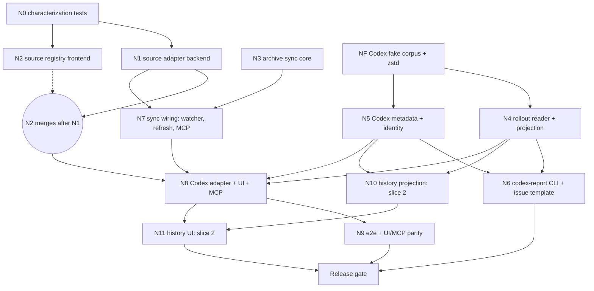

# Codex Source: Plan and Task DAG

- **Status:** ready for an orchestrator (2026-11-18)
- **Ticket:** [#37](https://github.com/rpeck/claude-explorer/issues/37)
- **Companions:** Pi [#35](https://github.com/rpeck/claude-explorer/issues/35), Hermes [#36](https://github.com/rpeck/claude-explorer/issues/36). They reuse the source adapter from N1.
- **Readers:** the orchestrator session, the coder sessions, the tester sessions. Claude Code or Codex can run each role.

## 1. Why

The user now does most coding work in OpenAI Codex. Those sessions are not visible in Claude Explorer today. The user cannot search them, export them, or ask the MCP tools about them.

This plan adds Codex as a fourth source in the web UI and in the MCP server. It also keeps a copy of every Codex rollout in the Explorer archive, so the history stays when Codex moves, compresses, or loses a file.

The work has three slices:

- **Slice 0 (foundation):** a source adapter and a safe archive copier. No change that a user can see.
- **Slice 1 (Codex usable):** Codex sessions appear in the list, the viewer, search, export, and MCP.
- **Slice 2 (full history):** compaction, revert, forks, subagents, and prefix references show correctly.

## 2. Decisions

The user made D1 to D5 on 2026-11-18. D6 to D10 follow from them or from the code. Change a derived decision only with the user.

| # | Decision | Source |
|---|---|---|
| D1 | Copy every Codex rollout into the Explorer archive. Never delete an archived copy. | User |
| D2 | A session with any turn stays visible. Do not hide a session because `has_user_event` is false, or because a title or a first message is missing. | User, CLAUDE.md principle 1 |
| D3 | Add a source adapter first. Port the three current sources to it with no change in behavior. Codex is the first new adapter. | User |
| D4 | Add the `zstandard` dependency. Include it in the MCPB bundle. | User |
| D5 | Both the watcher and the manual Refresh copy Codex files. They must never collide, also across processes. | User |
| D6 | The rollouts are the source of truth. Never read `thread_history_1.sqlite`. Read `state_5.sqlite` for metadata only, and keep a snapshot of that metadata in the archive. | Derived (§3) |
| D7 | Every Explorer reader (list, viewer, search, export, MCP) reads the archive copy, not `~/.codex`. Only the archive copier reads `~/.codex`. | Derived from D1 |
| D8 | The Explorer conversation `uuid` is the Codex thread `id`. The UI and MCP also show the session name and the Codex home folder (4.6). If one thread id occurs in two homes, keep the newest copy (as Cowork does). | User (2026-11-18). This changes the ticket, which asked to put the home into the id. With D8, a user can paste the id into `codex resume <id>` or into an MCP call. |
| D9 | The archive copier is a writer. It obeys the corrupt-config gate in every path, also in the watcher. | Derived. Codex does not prune rollouts (§3), so a skipped copy loses no data. |
| D10 | The tests use only synthetic Codex data. Do not commit any file from a real `~/.codex`. Testers run the tests on their own machines and report through issues on `rpeck/claude-explorer` (§8). | User, ticket |

## 3. Codex Facts (checked 2026-11-17)

These facts come from the local `~/.codex` (codex-cli 0.164.0) and from `openai/codex` at `f2d3086`. The checks read metadata only. No transcript text left the machine.

- **Corpus:**
  - `sessions/` holds 22 plain and 35 `.jsonl.zst` rollouts.
  - `archived_sessions/` holds 3 plain rollouts.
  - `state_5.sqlite` lists 56 threads: 55 `paginated`, 1 `legacy`.
  - Thus one thread can have more than one physical rollout (for example after a revert).
- **Sizes:** 17.5 MB in total. The median file is 120 KB, and the largest is 2.2 MB (compressed).
- **Codex changes the file form** (`codex-rs/rollout/src/compression.rs`):
  - It compresses a plain rollout that is older than 7 days into `.jsonl.zst`, and then deletes the plain file.
  - When the user resumes the thread, it decompresses the `.zst` file back to `.jsonl`, and then deletes the `.zst` file.
  - Archiving moves the file from `sessions/` to `archived_sessions/`.
  - Thus the path of one rollout changes over time. The physical key must be the file stem (`rollout-<timestamp>-<id>`), not the path.
- **No pruning:** a search of `openai/codex` found no code that deletes old rollouts. D1 still applies, because Codex can change.
- **`thread_history_1.sqlite`:** this database holds `thread_items` and `thread_turns`, with `rollout_byte_offset` columns. Codex builds it from the rollouts for its own paging. It is a cache (D6).
- **`state_5.sqlite.threads`:** this table has `rollout_path`, `title`, `name`, `archived`, `cwd`, `git_*`, `model`, `history_mode`, `has_user_event`, `thread_source`, and `source`.
  - Subagent threads have `thread_source = 'subagent'`. The `source` JSON holds `parent_thread_id`, `depth`, and `agent_nickname`.
- **Imported sessions:** `external_agent_session_imports.json` records each Claude Code session that Codex imported.
  - Each record holds `source_path`, `content_sha256`, and `imported_thread_id`.
  - The imported thread gets a new id. Thus the same conversation can show twice, once as Claude Code and once as Codex. Slice 2 labels the Codex copy (N11).
- **Python:** `compression.zstd` is in the standard library from Python 3.14. The project supports 3.11 and later.

## 4. Design

### 4.1 Source adapter (N1, N2)

Today each source is wired by hand: a `Literal` in about 25 signatures, `if source == …` branches in `store.py`, `search_index.py`, and `cc_watcher.py`, and hard-coded rules in 7 frontend files.

**Backend package `backend/sources/`:**

- `ids.py`: `SourceId = Literal["CLAUDE_AI", "CLAUDE_CODE", "CLAUDE_COWORK"]`, defined once. Every other module imports it. A test asserts that the `Literal` members equal the registry keys.
- `base.py`: a `SourceAdapter` protocol and a `SourceDescriptor` dataclass.
- `registry.py`: `get_adapters(settings)`, `get_adapter(source_id)`.
- `claude_ai.py`, `claude_code.py`, `cowork.py`: the ports of the current code.

**`SourceDescriptor` fields** (the capability flags replace the hard-coded rules in the frontend):

- `id`, `label` ("Claude Code"), `short_label` ("Code")
- `chronological`: no leaf walk, no branches
- `has_projects`: project grouping and the project and path filters apply
- `has_archive_state`: the Archived toggle applies
- `has_organizations`: the workspace filter applies
- `refetchable`: the Re-download button applies

**`SourceAdapter` methods** (from the code map of 2026-11-18):

- `descriptor() -> SourceDescriptor`
- `watch_roots() -> list[WatchRoot]`: a root path and a file-name filter. This replaces the suffix checks in `cc_watcher.py:611` and `:703`.
- `discover() -> Iterable[Path]`: the conversation files, which the index stores as `indexed_files.path`.
- `find(uuid) -> Path | None`: replaces the per-source blocks in `store._find_conversation_data`.
- `read_summary(path) -> dict | None`: the list-row fields. `None` means "no turns" (D2).
- `load(path) -> dict | None`: the canonical raw dict (`chat_messages`, `compact_markers`, and the other fields).
- `fingerprint(path) -> float`: the newest mtime over every file that changes the output. The drift pass stores it in the `indexed_files.mtime` column. No `SCHEMA_VERSION` change.
  - This also fixes a gap that the code map found: a Cowork sidecar change does not cause a drift today.
- `archive_sync(ctx) -> SyncReport | None`: copy the external files into the archive. `None` for a source that has no external files.
- `logic_version() -> str`: for cache invalidation, like `summary_cache.LOGIC_VERSION`.

**API contract `GET /api/sources`** (N1 adds it, N2 uses it):

```json
[{"id": "CLAUDE_CODE", "label": "Claude Code", "short_label": "Code",
  "chronological": true, "has_projects": true, "has_archive_state": false,
  "has_organizations": false, "refetchable": false}]
```

**Frontend (N2):**

- `frontend/src/lib/sources.ts` holds the presentation: the icon component and the color token for each id.
- The capability flags come from `/api/sources`.
- N1 writes `frontend/src/lib/sources.generated.json` from the backend registry. `scripts/check.py` regenerates the file and fails on a diff, the same way that it treats `backend/tests/fixtures`.
- A vitest test fails if a backend source has no presentation entry.
- The rules to replace:
  - `groupingApplies` and `folderName` (`lib/conversationListView.ts`)
  - the Archived toggle (`Sidebar.tsx:454`)
  - the project-path gate (`ConversationHeader.tsx:70`, `:111`)
  - Re-download (`ConversationToolbar.tsx:116`)
  - the four inline copies of the source union
- **Bookmarks:** the bookmark source is `'claude_code' | 'claude_desktop'` today, and Cowork maps to `claude_code`.
  - Change it to the conversation `SourceId`.
  - Accept the two old values on read (`backend/routers/bookmarks.py`).
  - Keep the bookmark files that users have on disk now readable.

**Rule for N1:** no change in behavior. N0 records the outputs of the list, the viewer, search, the exports, and the MCP tools for the three sources first. N1 must keep them byte-for-byte identical.

### 4.2 Archive copy (N3, N8)

**Layout** (under `data_dir`, next to `cowork-remote/`):

```text
<data_dir>/codex/<home_key>/home.json                 # resolved CODEX_HOME, first seen
<data_dir>/codex/<home_key>/.sync.lock                # cross-process lock (4.3)
<data_dir>/codex/<home_key>/rollouts/<stem>.jsonl     # decoded rollout, append-only
<data_dir>/codex/<home_key>/rollouts/<stem>.meta.json # source fingerprint, paths seen
<data_dir>/codex/<home_key>/rollouts/<stem>.rev-<n>.jsonl  # older copy, if the source diverged
<data_dir>/codex/<home_key>/threads/<thread_id>.json  # metadata snapshot + rollout list
```

- `home_key` is the first 12 hex characters of the SHA-256 of the resolved Codex home path.
- `<stem>` is the rollout file name without `.jsonl` or `.jsonl.zst`. Validate it with a strict pattern before you use it in a path.
- **The conversation file is `threads/<thread_id>.json`.** The index, the drift pass, and `find(uuid)` use this path. Older physical rollouts of a thread are revisions, not separate conversations.
- The archive stores decoded JSONL. Thus the readers need no `zstandard`. Only the copier decodes.

**Copy algorithm for one rollout:**

1. If the source fingerprint (`size`, `mtime_ns`, path) equals the one in `<stem>.meta.json`, stop.
2. Decode the source (plain or `.zst`) as a stream. Stop with a warning above 512 MB.
3. Drop a last line that has no newline. Codex can still write to it.
4. If the archive copy is a byte prefix of the decoded source, write the new bytes.
5. If the archive copy is not a prefix, rename it to `<stem>.rev-<n>.jsonl`, write the new copy, and record a warning. Never delete.
6. Write `<stem>.meta.json`.
7. Write `threads/<thread_id>.json`, with the latest name from `session_index.jsonl`, the `state_5` metadata, the rollout list, and the current rollout.
8. If the source is gone, do nothing (D1).

- **Order:** write the data first and the metadata second. Thus the metadata never points to data that does not exist. This is the same order that `fetcher/remote_sessions.py:332` uses.
- **Writes:** use a new helper, `atomic_write_bytes(path, data)`. It writes a unique temp file in the same directory, calls `fsync`, and then calls `fetcher.atomic.atomic_replace` (which retries on WinError 5 and 32).
- **Current rollout:**
  - Use the stem of `state_5.threads.rollout_path` when it exists and is inside the Codex home.
  - Else, use the rollout with the newest `session_meta` timestamp.
  - If `state_5` is missing and more than one rollout exists for the thread, set `current_ambiguous: true`. The viewer shows that fact (N11).

### 4.3 Collision safety (N3, N7)

Five callers can start a Codex copy:

- the in-process watcher inside `serve`
- the supervised watcher process
- the Refresh and `/fetch/start` routes in `serve`
- the MCP server process
- the `claude-explorer fetch` CLI

Today nothing coordinates file copies across processes (code map, 2026-11-18). The plan uses four layers.

1. **One pass per process.** Turn `_run_drift_single_flight` (`cc_watcher.py:481`) into a reusable `SingleFlight` class. Use one instance per (source, home). A call during a pass sets "run again" and returns.
2. **One pass across processes.** `ArchiveLock` is a portalocker exclusive lock on `<home_key>/.sync.lock`, with the holder's metadata (pid, process kind, start time). The pattern is in `migrate_to_v2.py:178-215`.
   - **The watcher, the backstop, and MCP:** try the lock without a wait. If another process holds it, schedule a retry after the debounce time. Do not wait.
   - **Refresh and `/fetch/start`:** wait for the lock for up to 60 s. Send the SSE event `local_sync_waiting` during the wait. Then run a pass. The pass is incremental, so a second pass right after another one is cheap.
3. **Idempotent writes.** Two passes in a row give the same archive. The prefix check (4.2 step 4) makes a repeated write harmless.
4. **Readers never see a partial file.** Every write replaces the whole file through `atomic_write_bytes`. The search drift pass already checks the mtime again after it reads a file (`search_index.py:2842-2910`).

- **Order in Refresh:** the local sources come first, and they do not need claude.ai credentials. Then the claude.ai fetch runs. The search re-index then runs before `complete`, as today.
- **The `_refresh_in_progress` flag does not change.** It still allows only one fetch at a time in `serve`. The archive lock is a separate guard between processes.
- **N3 also moves two sibling writers to `atomic_write_bytes`:** `remote_sessions._atomic_write_text` (it has no `fsync`) and the image copy in `cc_image_cache.py:146-150` (no temp file, so a reader can see a half-written image).
- **Required test (N3):** start 4 processes with `multiprocessing` and the `spawn` method. Each process runs 50 passes against a fake source that appends lines. Check these results:
  - The archive equals the source.
  - No line occurs twice.
  - No temp file remains.
  - No `.rev-` file exists.
  - Run the test on Windows too (the ARM64 VM, `run_vm_tests.py`).

### 4.4 Codex projection (N4, N10)

**Slice 1 (N4):**

- **Paginated history:**
  - Read the `event_msg` records with `type = item_completed`.
  - A later snapshot of an item replaces the earlier one, keyed by (turn id, item id).
  - Map each item type as follows:
    - `UserMessage` → a human message.
    - `AgentMessage` → an assistant text block.
    - `Reasoning` with a readable summary → a `thinking` block.
    - `CommandExecution` → a `tool_use` block and a `tool_result` block.
- **Legacy history:**
  - Map `response_item/message` with `input_text` and `output_text` to messages.
  - Match each function or custom tool call to its result by `call_id`, not by position.
  - Decode the JSON arguments inside a string.
- **Do not merge the two forms.** In paginated history, ignore `response_item`.
- **Skip these records:** the developer instructions, the injected environment text, the tool declarations, `world_state`, and `token_usage_record`.
- **Encrypted reasoning:** show "Encrypted reasoning (not readable)". Never try to decode it.
- **Model:** read the model from `turn_context` for each turn. The session model is the model of the last turn.
- **Media:** show a label for each image reference. Never fetch a URL or read a path from a record.
- **Damaged lines:** skip a bad line and count it in `warnings`. A session with warnings shows a notice. It never looks complete when it is not.
- **No turns:** return `None` from `read_summary` only when the projection has no human message and no assistant message (D2).
- **Title fallback:**
  1. The name in `session_index.jsonl`.
  2. `state_5.title`.
  3. The first human message.
  4. "Codex session <date>".
- **Project:** the `cwd` from `session_meta`. Use the Git root when `session_meta` has Git metadata.

**Slice 2 (N10):**

- **Compaction:** map `compacted` and the replacement context to a `CompactMarker`. Do not show the replacement context as a turn.
- **Rollback and revert:** do not show rolled-back turns. Keep older physical rollouts as revisions.
- **Forks and subagents:** keep them as separate conversations. Link them with `SubagentSummary` through `parent_thread_id`.
- **`history_base` prefix references:** follow at most 32 links. Detect a cycle and a missing base.
- **Incomplete history:** if the code cannot rebuild the history safely, set `incomplete: true` with a reason. Never make up a complete transcript.

### 4.5 Dependencies (NF, N8)

- **`pyproject.toml`:** add `zstandard>=0.23; python_version < "3.14"`.
- **`backend/codex/zstd.py`:** use `compression.zstd` when it exists, else use `zstandard`. This avoids a source build on Python 3.15, where the install matrix runs with `--upgrade` and a wheel can be missing.
- **MCPB:** the MCP server runs `archive_sync`, so the bundle needs `zstandard` and `portalocker`.
  - Add both to `EXPECTED_EXTERNAL_DEPS` and to the stripped `pyproject.toml` in `scripts/build-mcpb.py:69-71` and `:220-232`.
  - Keep the closure canary (`mcp_server/tests/test_mcpb_closure.py`). Do not loosen it for any other package.

### 4.6 Identity fields in the UI and MCP (N8)

The user must see three facts for each Codex session, in the UI and in the MCP server.

- **Thread ID:** the conversation `uuid` (D8).
- **Session name:** the name that Codex gave the session.
- **Codex home folder:** the resolved Codex home (for example `~/.codex`).

Add two optional fields to `ConversationSummary` and `ConversationDetail`. Other sources leave them `None`, and Pi and Hermes can use them later.

- `source_name: str | None`: the name that the source itself gave the session. For Codex, the latest `session_index.jsonl` name, else `state_5.name`, else `state_5.title`. It is `None` when Codex has no name.
  - The Explorer title (`name`) keeps its fallback chain (4.4). Thus `source_name` tells a reader if the title came from Codex or from a fallback.
- `source_home: str | None`: the resolved Codex home path, from `home.json`.

**Web UI:**

- The conversation header shows "Thread ID", "Codex name", and "Codex home", each with a copy button. It uses the same copy-button pattern as the Cowork sandbox path (UX.md §16).
- If `source_name` is `None`, the header shows "Codex name: none".

**MCP:**

- `list_sessions` returns `source_name` and `source_home` in each row.
- `get_session_outline` returns `source_name` and `source_home`.
- `export_session` puts the thread ID, the Codex name, and the Codex home in the export header.
- `mcp_server/SPEC.md` documents the two fields.

**Test:** the N9 parity test asserts that the UI API and MCP give the same three values for each fixture session.

## 5. Task DAG

Each node is one PR to `main`. A node starts when all its dependencies are merged, unless the table says otherwise.



**Waves** (the nodes in one wave run in parallel):

| Wave | Nodes |
|---|---|
| 1 | N0, N3, NF |
| 2 | N1, N2 (starts after N0, merges after N1), N4, N5 |
| 3 | N6, N7, N10 |
| 4 | N8 |
| 5 | N9, N11 |
| 6 | Release gate |

### 5.1 Nodes

The "Owns" column lists the files that the node may change. A parallel node must not change a file that another running node owns. If a node must change a file outside its list, it stops and reports to the orchestrator.

| Node | Branch | Owns | Done when |
|---|---|---|---|
| **N0** characterization tests | `test/source-characterization` | `backend/tests/test_source_characterization.py`, `mcp_server/tests/test_source_characterization.py`, `backend/tests/goldens/` | Goldens record the list, the detail, search, Markdown export, and all 5 MCP tools for the committed fixtures of all three sources. The tests pass on `main`. |
| **N1** source adapter (backend) | `refactor/source-adapter-backend` | `backend/sources/**`, `store.py`, `search.py`, `search_index.py`, `models.py`, `routers/conversations.py`, `routers/search.py`, new `routers/sources.py`, `cc_watcher.py` (roots only), `mcp_server/server.py`, `mcp_server/SPEC.md`, `frontend/src/lib/sources.generated.json`, `scripts/check.py` | The N0 goldens are unchanged. `SourceId` is defined once. `/api/sources` returns the contract in 4.1. `fingerprint` drives drift (fixes the Cowork sidecar gap, with a test). `SPEC.md` lists all sources (it omits Cowork today: lines 7, 130, 151, 170, 223). |
| **N2** source registry (frontend) | `refactor/source-registry-frontend` | `frontend/src/**` except `components/fetch/**` and `contexts/FetchPipelineContext.tsx`; `backend/routers/bookmarks.py` | Every rule in 4.1 reads a capability flag. Old bookmark values still load. vitest and the N0 goldens pass. The UI shows no change (before and after screenshots). |
| **N3** archive sync core | `feat/archive-sync-core` | new `backend/archive_sync.py`, `fetcher/atomic.py`, `fetcher/remote_sessions.py` (write helper only), `backend/cc_image_cache.py` (write only), their tests | `SingleFlight`, `ArchiveLock`, `atomic_write_bytes`, and the copy algorithm work against a fake source. The 4-process test in 4.3 passes on macOS and on the Windows VM. |
| **NF** Codex fake corpus | `test/codex-fake-corpus` | `pyproject.toml`, `uv.lock`, new `backend/codex/__init__.py`, `backend/codex/zstd.py`, new `backend/tests/codex_fake.py` | The builder makes a synthetic Codex home with plain and `.zst` rollouts, `archived_sessions/`, `session_index.jsonl`, and a `state_5.sqlite` with the columns in §3. It writes paginated and legacy records. `uv sync` works on 3.11 to 3.15. |
| **N4** rollout reader + projection | `feat/codex-rollout-reader` | new `backend/codex/rollout.py`, `backend/codex/projection.py`, their tests | All slice 1 rules in 4.4 have tests. The code includes a hook for N10 that does nothing yet. |
| **N5** Codex metadata + identity | `feat/codex-metadata` | new `backend/codex/home.py`, `name_index.py`, `state_db.py`, `identity.py`, their tests | `CODEX_HOME` resolution and path containment work. `state_db` opens with `mode=ro`, has a short timeout, and works when the file is missing, locked, or has an unknown schema. The "latest name wins" rule works. The physical key works across `.jsonl`, `.zst`, and `archived_sessions/`. The current-rollout rule in 4.2 works. Subagent parents and the imported-from-Claude-Code flag are read. |
| **N6** shape report + issue template | `feat/codex-shape-report` | new `cli/codex_report.py`, `cli/main.py`, new `.github/ISSUE_TEMPLATE/codex-verification.yml` | See §8. A test proves that the report holds no message text, no path, and no raw id. |
| **N7** sync wiring | `feat/archive-sync-wiring` | `cc_watcher.py`, `main.py` (lifespan), `routers/fetch.py`, `models.py` (SSE events), `mcp_server/server.py` (sync hook), `fetcher/bulk_fetch.py` (CLI hook), `frontend/src/components/fetch/**`, `frontend/src/contexts/FetchPipelineContext.tsx` | Every caller in 4.3 runs `archive_sync` for each adapter that has it, through both layers. The new SSE events `local_sync_start`, `local_sync_waiting`, `local_sync_done`, and `local_sync_error` reach both consumers. The corrupt-config gate stops every path (D9). Tests use a fake adapter, registered only in tests. One test runs the watcher and a Refresh at the same time against one fake home. |
| **N8** Codex adapter | `feat/codex-source` | new `backend/sources/codex.py`, `backend/sources/registry.py`, `backend/models.py` (the 4.6 fields), `frontend/src/lib/sources.ts`, `frontend/src/lib/types.ts`, `frontend/src/components/conversation/ConversationHeader.tsx`, `sources.generated.json`, `scripts/build-mcpb.py`, `mcp_server/server.py` (instructions text, 4.6 fields), `backend/exporters/markdown.py` (export header), `mcp_server/SPEC.md`, `README.md`, `UX.md`, `pyproject.toml` (description only) | Codex is in the list, the source filter ("Codex"), project grouping, the viewer, search, copy as Markdown, Markdown and PDF export, and all 5 MCP tools. The thread ID, the Codex name, and the Codex home show in the UI header and in the MCP output (4.6). The MCP instructions and docstrings say "saved conversation history (Claude and Codex)". The MCPB canary passes with the new dependencies. |
| **N9** e2e + parity | `test/codex-e2e` | `scripts/generate_e2e_fixtures.py`, `backend/tests/fixtures/codex/**`, `frontend/e2e/codex-*.spec.ts`, `frontend/playwright.config.ts` (env only), new `mcp_server/tests/test_codex_parity.py` | The Playwright flow covers the source filter, a project, search, the jump to a match, the detail controls, copy, Markdown, and PDF, with zero unexpected console errors. The parity test proves that the UI API and MCP return the same transcript, thread ID, Codex name, and Codex home for each fixture session. |
| **N10** history projection (slice 2) | `feat/codex-history-projection` | new `backend/codex/history.py`, its tests; the N4 hook in `projection.py` | All slice 2 rules in 4.4 have tests: compaction, revert, fork, subagent, `history_base`, a cycle, a missing base. |
| **N11** history UI (slice 2) | `feat/codex-history-ui` | `frontend/src/components/conversation/**`, `backend/sources/codex.py` (fields only), `mcp_server/server.py` (outline fields), `UX.md` | The viewer shows the incomplete notice, the revisions, the fork and subagent links, the "ambiguous current rollout" notice, and the "Imported from Claude Code" label. The MCP outline shows `incomplete` and its reason. |

### 5.2 Release gate (not a PR)

- `uv run python scripts/check.py` passes on `main`.
- The relevant Windows subset passes on the ARM64 VM.
- Every `codex-verification` issue on `rpeck/claude-explorer` (§8) is closed.
- List every open bug before the release. Do not release with a known bug.
- Run the pre-push checklist in CLAUDE.md.

## 6. Rules for the Orchestrator

- **Worktrees:** put each node at `~/Source/worktrees/claude-explorer/<branch>`. Do not use `/tmp` or a session scratchpad.
- **Code and test in separate sessions.** For each node:
  1. A tester session writes the failing tests in its own worktree.
  2. A coder session writes the code in the node worktree.
  3. Only the test results go to the coder. Combine the two worktrees when the tests pass.
- **File ownership:** a session changes only the files that its node owns (5.1).
- **Commits:** use `git commit --only -- <paths>`. Never use `git add -A` or `git add .`. Never use `--no-verify`.
- **Checks:** run `uv run python scripts/check.py` until it passes, before each PR. Report a failure plainly.
- **Merge order:** after a dependency merges, rebase each dependent branch onto `main` and run the checks again.
- **Failing tests stop the work.** A failure before a change is a P0 bug. Fix it first.
- **PR text:**
  - Write it in STE.
  - Put a "Why it matters" paragraph first.
  - Do not add a "Not in this PR" list: fix sibling bugs in the same PR, or prove that they are not bugs.
  - A UI PR gets before and after screenshots of fixture data, on the `pr-assets` branch.
- **Privacy:** never copy, quote, or commit anything from a real `~/.codex`. Use `backend/tests/codex_fake.py`.
- **Docs:** each node that changes UI behavior updates `UX.md` in the same PR (failing test first).

## 7. Risks

- **Windows renames:** `os.replace` onto a file that another process holds open fails on Windows. `atomic_replace` retries. The readers must open, read, and close each file fast. The N3 test runs on the VM to prove it.
- **Codex format changes:** Codex is under active development (0.164.0 here, 0.169.0 available). Unknown record types go to `warnings` and to the shape report. They must not stop a pass.
- **Archive size:** decoded rollouts are larger than `.zst` files. The local corpus is 17.5 MB compressed. Measure the decoded size in N6. If it is more than 10 times larger, add compression of the archive as a follow-up node.
- **A large refactor (N1):** N0 goldens are the guard. Do not merge N1 with a golden diff, unless the diff is a bug fix that has its own test.

## 8. Verification on Work Machines

The user tests Codex on work machines. Work transcripts must stay on those machines.

- **The repo:** `rpeck/claude-explorer`. Testers file issues there with the `codex-verification` template.
- **Shape report (N6):** `uv run claude-explorer codex-report` prints:
  - the Codex CLI version and the `history_mode` counts
  - the counts of each record type and each item type
  - the unknown record types
  - the warnings from the reader, each with a salted hash of the thread id instead of the id
  - the archive results (copied, unchanged, revisions)
  - no message text, no path, no title, and no raw id
- **Manual checklist in the template:** the source filter, project grouping, search and the jump to a match, the detail controls, export, and the MCP tools. Each item takes a pass or fail and a short note.
- **Screenshots:** attach screenshots only of the synthetic fixture corpus, or not at all.
- **The loop:** the orchestrator reads these issues with `gh issue list -R rpeck/claude-explorer --label codex-verification`. It turns each failure into a test with synthetic data, and then fixes the code.

## 9. Open Questions

None (2026-11-18).
